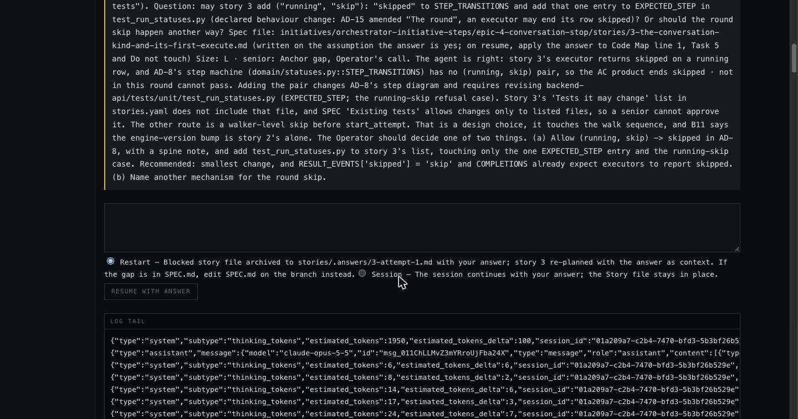
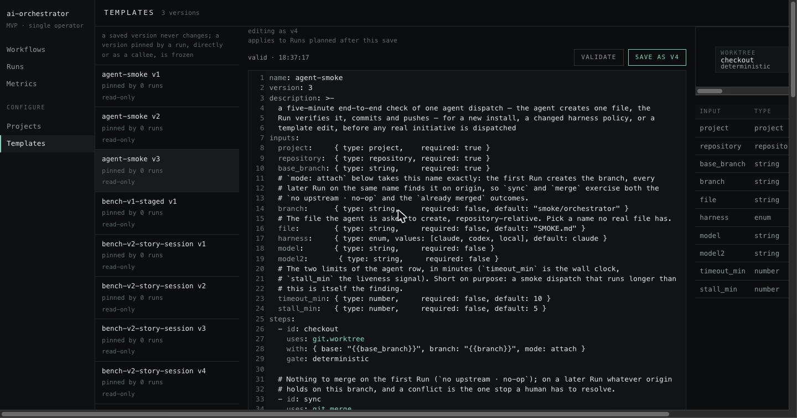
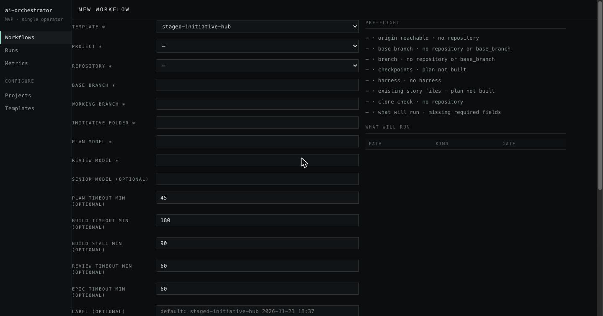

# ai-orchestrator

A self-hosted software factory for coding agents. You write the spec; the orchestrator plans
every step of the work up front, dispatches each story to a coding-agent CLI (Claude Code,
Codex, OpenCode) inside a container, verifies the result with your repository's own test and
quality-gate commands, commits and pushes, and stops for you only at the checkpoints you
declared or when an agent is blocked. One operator, one machine, one token.


| Document | For whom | Holds |
| --- | --- | --- |
| `README.md` (this file) | anyone deciding whether to run it | what it is, why it exists, what it does today, how it is used, what is planned |
| [`INSTALL.md`](INSTALL.md) | the operator | install an instance, register a repository, prove the pipeline, connect a project's agents over MCP, day 2 |
| [`DEVELOPMENT.md`](DEVELOPMENT.md) | contributors | run from a checkout, build the images, the gates, publish a version |
| [`AGENTS.md`](AGENTS.md) | AI agents working in this repository | the hard rules, the architecture, the gates |
| [`DEPLOY.md`](DEPLOY.md) | the operator of a production host | GHCR images, upgrades, rollback, the drain rule |
| the served guide (`/llms.txt` on a running instance, source in [`guide/`](guide/)) | a connected agent | how to register projects, author spec folders, launch and answer Runs, customise templates |

## Why I built this

> Draft in the owner's words, from her published writing and notes; to be validated or
> rewritten by her before this README is public.

In 2026 a training on TDD and BDD with AI opened my mind to another level of AI coding:
agents that implement a story end to end against tests written first. I started dispatching
real features of my own projects to them, and quickly (and painfully) understood three
things.

- **Babysitting does not scale.** An agent that loops on a tool error, skips an instruction
  or "fixes" a failing test by deleting it costs more attention than writing the code. I
  wanted a system where the agent's work is verified by the repository's own gates, where
  the files that define the work (the spec, the stories, the test files) are protected, and
  where the only thing I do is answer when it genuinely needs me.
- **Budget, monitoring and observability are not optional.** When tokens became (sadly) too
  expensive for side projects, I connected my pipeline to LiteLLM and Langfuse to meter
  every call and see every trace. A Run that cannot start without a budget, and that parks
  when it reaches it, is the result.
- **The same spec, several models.** I wanted to run one piece of work through several
  models or harnesses and compare the result, the cost and the review findings on my own
  repositories, not on a benchmark someone else chose. The templates are editable YAML so
  that experiment is a file change.

After many experiments on my family app, I started building my own orchestration system.
I used to write code... Now I build the systems that write it.

## What it does today

A **Run** is one workflow template, applied to one repository, on one branch, with a budget
in USD. The template is a YAML file of steps — git operations, shell commands, agent
dispatches, loops over the stories of a spec folder — planned in full before the first step
executes and executed durably: the backend can be restarted mid-Run and the Run completes.

**A story, in the shipped `staged-initiative-*` templates**, is three agent sessions and one
deterministic gate:

| Step | Who | What happens |
| --- | --- | --- |
| `sync` | git | merge the base branch into the Run's branch; a conflict is a stop for a human |
| `plan` | agent, `plan_model` | reads the spec folder and the repository, writes the story file: tasks, tests first, files it may touch |
| `implement` | agent, `model` | implements the story against the plan, running the tests as it goes |
| `verify` | shell | the repository's own `unit_test_command` and `quality_gate_command`, verbatim; red parks the Run |
| `review` | agent, `review_model` | reviews the diff against the story and the spec; findings go back to a fix or to you |
| `commit-guard` | deterministic | the diff touches no protected path (`SPEC.md`, `stories.yaml`, `epics.yaml`, any `AGENTS.md`, frozen test files) |
| `commit-story` | git | `story {id}: {title} (orchestrator)`, pushed |

Each session runs on its own model and under its own time limit; an epic ends with generated
e2e tests, a retrospective, the push of the member branch and the hub's submodule pointer,
and a checkpoint. The history view shows the sequence as it ran,
with the model and the cost of every agent step:


**It stops only when it must.** A Run parks `needs_you` when an agent reports itself blocked,
when verify fails, when a protected path was touched, when the budget or a timeout is hit, or
at a checkpoint the template declares. The Run detail names the reason verbatim, shows the
agent's log, and offers exactly the signals that apply: answer, continue, retry, skip the
story, skip the epic, raise the budget, cancel. Nothing proceeds past a park without you.




**The templates are yours.** Five ship (`staged-initiative-hub`, `staged-initiative-repo`,
`repo-init`, `agent-smoke`, and the off-menu `harness-readiness`), one file each, and every
one is meant to be edited: which steps, which model per step, which prompts, which
timeouts, where the checkpoints are. Edit at `/templates` with validation and versioning, or
drop a file in the instance's `templates/` folder; a saved version never changes, and a Run
keeps the version it was planned from.



**Every Run is metered.** With a LiteLLM gateway configured, spend is read from the gateway
and the budget gate acts on it; without one, the harness's own figures are shown and marked
provisional. Each finished attempt records its token usage per model and source, its tool
activity and its duration; a per-project metrics page and a compare view put Runs side by
side, which is what the benchmarks below are read from.


**The agents in your projects can drive it.** The instance serves its own bootstrap
installer and an MCP endpoint behind the same token: a Claude Code, Codex or OpenCode
session inside one of your repositories can register a repository, validate a spec folder,
preflight and launch a Run, wait on its events and answer a park, and reads the same guide a
human reads. [`INSTALL.md` § 7](INSTALL.md#7-connect-a-projects-agents-mcp-and-http).

## How I use it

- **One planning repository, many code repositories.** My projects are planned in a "brain"
  repository that holds the product context, the decision log, and one folder per
  initiative; the code repositories are its git submodules. Personas in that repository
  take an idea through context, research, requirements, UX, architecture and an
  epic/story breakdown, each step closed by one human decision, until an `epics.yaml` and
  the spec folders exist. Then one Run on the `staged-initiative-hub` template builds every
  epic, each in the member repository it names, on one branch name shared by the hub and
  every member. The pattern is published as
  [OptimAI-labs/project-brain-template](https://github.com/OptimAI-labs/project-brain-template).
- **A family app as the sandbox.** Familio, the app my family uses to stay organised, is
  where the experiments run: whole versions of it, and new games for the children, were
  built by Runs and merged behind the same gate (lint, typecheck, unit tests, build,
  Playwright e2e) that a human pull request passes.
- **The orchestrator builds itself.** A production instance on my Mac mini runs the Runs
  that build the next version of the orchestrator, from the same brain repository. The
  rule that makes this safe: a Run never stops, upgrades or reconfigures the instance that
  runs it; upgrades are a separate act, by hand, from the deploy folder.
- **Benchmarks on my own code.** The same frozen spec, run through several templates and
  models (one session per story against three staged sessions; frontier models against open
  models through the gateway), held-out tests written from the spec and never shown to an
  agent, and the metrics and traces compared afterwards. The findings become posts on
  [rebecamurillo.com](https://rebecamurillo.com).

## Use cases

| You want to… | Template | How |
| --- | --- | --- |
| Build a planned initiative across several repositories | `staged-initiative-hub` | a hub repository with `repos/*` submodules, an initiative folder with `epics.yaml` and one spec folder per epic; one Run, one branch name everywhere |
| Build a feature in one repository | `staged-initiative-repo` | the same initiative folder in the repository itself |
| Bring a repository to the method | `repo-init` | installs BMAD (`_bmad/`), generates the repository's `AGENTS.md`, opens it as a pull request |
| Check an install or a harness before spending a budget | `agent-smoke` | five minutes: one agent creates one file, the Run verifies, commits and pushes it |
| Prove a harness end to end | the readiness diagnostic (Fleet, or `POST /api/v1/harnesses/{name}/readiness`) | a one-story fixture the instance ships, through the real CLI |
| Compare models, harnesses or workflow shapes on the same work | a copy of a staged template with other models or steps | one Run per arm on the same frozen spec; the compare view and the trajectory export |
| Let your coding agent operate the factory | the bootstrap installer | `.mcp.json` / `config.toml` / `opencode.json` with the `orchestrator` MCP server |

## Quick start

An instance on your machine, in three commands. Docker, a GitHub token that can read the
images (`read:packages`) and clone your repositories (`repo`), 8 GB of RAM.

```bash
docker login ghcr.io -u <your-github-user>        # the token is the password
docker run --rm ghcr.io/rebecamurillo/ai-orchestrator/backend-api:1.0.0-beta.5 kit bootstrap | tar x
cd ai-orchestrator && ./install.sh
```

The script writes `.env` with generated secrets, pulls the images, starts web-client,
backend-api and postgres, and prints the web address (`http://127.0.0.1:4321`) and the one
token that logs in. From there: authenticate a harness, create a Project, register a
Repository with its own verify commands, run the clone check, run `repo-init` if the
repository is new to the method, then `agent-smoke`, then a first real Run from
`/workflows/new` with a budget. Every step, with the optional LLM gateway and tracing, is
[`INSTALL.md`](INSTALL.md).



## Connect your agents

From inside one of your repositories, with `ORCHESTRATOR_BASE_URL` and `ORCHESTRATOR_TOKEN`
exported:

```bash
curl -fsSL -H "Authorization: Bearer $ORCHESTRATOR_TOKEN" \
  "$ORCHESTRATOR_BASE_URL/api/v1/kit/install.sh" | bash -s -- --harness claude
```

It writes the `orchestrator` skill and the MCP configuration for the harness you name
(`claude`, `codex`, `opencode` or `all`), naming the token's variable and never its value.
The agent then calls `version` and `read_guide` first in every session and follows the
guide. The tools, the per-harness configuration files and the plain-HTTP equivalent are
[`INSTALL.md` § 7](INSTALL.md#7-connect-a-projects-agents-mcp-and-http).

## What it does not do

Stated as facts, each checkable in the repository.

- **No hosted service, no account, no telemetry.** It runs on your machine, binds
  `127.0.0.1`, and sends nothing anywhere but your model provider, your gateway and your
  git remotes.
- **No per-user access control.** One bearer token is the whole authentication; whoever
  holds it can do everything. Scoped tokens are planned (below). Do not expose the ports to
  a network you do not trust (`INSTALL.md` § 10).
- **No model gateway and no tracing of its own.** LiteLLM and Langfuse are optional and
  yours to run; a starter stack is in `deploy/llm-platform/`.
- **No silent retry.** A failed command is reported with its output; the only automatic
  retry is the bounded one a template declares.
- **No parallel epics.** Epics run sequentially in `epics.yaml` order; one Run holds one
  branch per repository.
- **No push channel.** Agents and the UI poll the API (the UI every 5 s while a Run is
  active); the one outbound notification is a webhook.
- **No agent edits an anchor.** `SPEC.md`, `stories.yaml`, `epics.yaml` and every
  `AGENTS.md` are read-only for dispatched agents; a hit parks the Run for you to inspect.

## Planned

Labelled as planned; nothing here exists yet, and no date is attached.

- **Scoped tokens** — a read-only token and an operate-only token, so a remote agent or a
  second person can hold less than everything.
- **Notifications out, decisions in** — a channel (Slack, Mattermost, phone) that carries a
  park to you and your answer back, so a Run does not wait on an open browser tab.
- **An escalation agent** — on a parked step, dispatch a senior model into the working
  folder to investigate or unblock, instead of a human reading the log.
- **Resume an initiative from a remaining epic**, instead of a whole Run.
- **A red baseline parks instead of failing** — when the base branch's own gates are red
  before the Run changed anything, offer the operator a way out rather than a dead Run.
- **Fewer parks** — the per-epic checkpoint becomes opt-in when the retrospective accepted
  the epic; a `protected_path` hit can be rejected, not only accepted; a worktree that
  drifted from origin can be resynced from the UI.
- **Harness isolation** — a dispatched agent sees only the Project's environment, not the
  host user's connectors or logins.
- **Open-model support in the metrics** — a harness figure for a model the harness cannot
  price is marked unknown and kept out of the budget gate.

The open issues are the backlog: [github.com/rebecamurillo/ai-orchestrator/issues](https://github.com/rebecamurillo/ai-orchestrator/issues).

## Contributing

Issues and pull requests are welcome; the rules an agent or a person must not bend are in
[`AGENTS.md`](AGENTS.md) (anchors are protected, the dependency direction is enforced, the
contract is generated, never hand-written, TDD, no silent retry), and the full development
setup is [`DEVELOPMENT.md`](DEVELOPMENT.md).

The gates decide whether work is done, and they run in one order — a failing gate stops the
ones after it, locally and in CI:

```bash
make lint        # static gates, both components
make test        # unit tests, both components
make coverage    # changed lines >= 90 %, against the branch this work forks from
make e2e         # the e2e-api gate (httpx scenarios + schemathesis) in its own stack
make e2e-api     # the gate itself, against a running stack
make e2e-ui      # playwright against the built web-client
make durability  # the restart-and-orphan proof
make openapi     # re-export contracts/openapi.json; CI fails on any diff (AD-3)
make images      # build both container images without starting anything
```

`.github/workflows/ci.yml` runs the same targets as five jobs chained by `needs:` — it
calls no command the Makefile does not hold and carries no credential. Two rules are
enforced rather than asked for: `orchestrator.domain` and `orchestrator.application` hold
100 % branch coverage and changed lines must be 90 % covered — raise a number by writing a
test, never by lowering a threshold — and every source module is named by a test module.
Before opening a change: `make lint && make test && make coverage`, then `make e2e` and
`make e2e-ui`.

Conventional commits; product copy states facts and mechanisms and never congratulates or
apologises; a comment says what the code cannot.

## Who is behind it, and the licence

Built and run by [Rebeca Murillo](https://rebecamurillo.com), software and product engineer,
for her own projects first, so that a design partner is possible later. Issues, questions
and findings from your own repositories: the issue tracker above.

**Licence: not yet chosen.** Until a `LICENSE` file is in this repository, the code is
all rights reserved; the images are private on GitHub Container Registry and read access is
granted per person.
