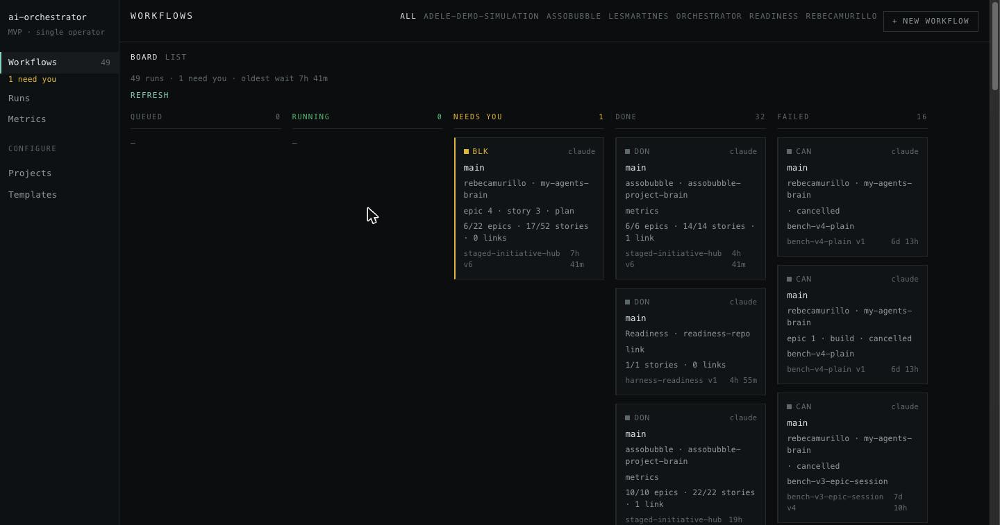
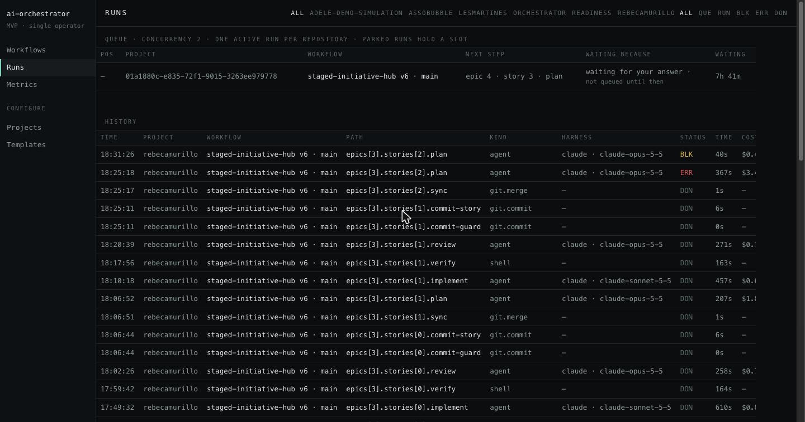
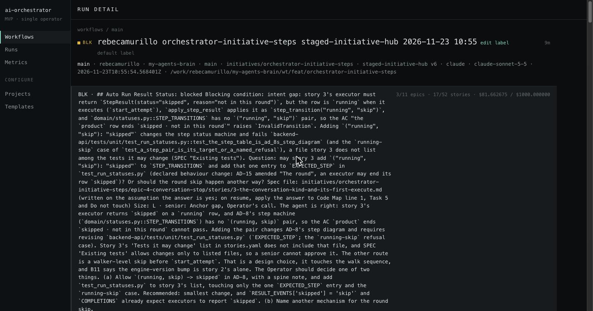
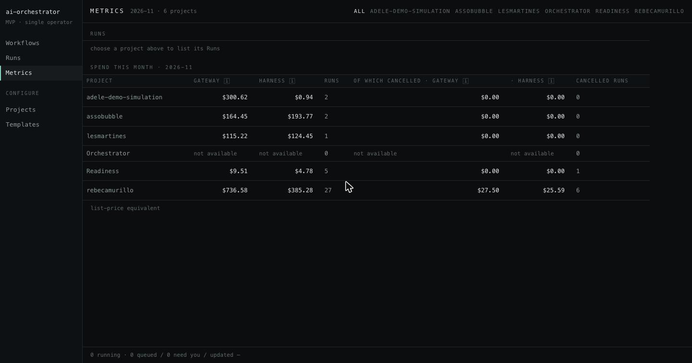

# ai-orchestrator

A self-hosted workflow engine for coding agents. A workflow is a YAML file, the way a GitHub
Actions workflow is: steps that check out a branch, run shell commands, dispatch a
coding-agent CLI (Claude Code, Codex, OpenCode) with a prompt and a skill, loop over the
items of a file, commit, push, and stop for a human at the points you declare. The
orchestrator plans every step up front, executes them durably inside a container, verifies
each result with the repository's own commands, meters what every agent step cost, and
analyses what it changed.

The workflows that ship are the ones I use — a spec-driven development process with tests
first, three agent sessions per story, and a review gate — and they are examples, not the
product: edit them, or write your own for any process a repository can hold, from a
migration to a documentation pass to a business workflow that happens to live in git. One
operator, one machine, one token.



| Document | For whom | Holds |
| --- | --- | --- |
| `README.md` (this file) | anyone deciding whether to run it | what it is, why it exists, what it does today, how it is used, what is planned |
| [`INSTALL.md`](INSTALL.md) | the operator | install an instance, register a repository, prove the pipeline, connect a project's agents over MCP, day 2 |
| [`DEVELOPMENT.md`](DEVELOPMENT.md) | contributors | run from a checkout, build the images, the gates, publish a version |
| [`AGENTS.md`](AGENTS.md) | AI agents working in this repository | the hard rules, the architecture, the gates |
| [`DEPLOY.md`](DEPLOY.md) | the operator of a production host | GHCR images, upgrades, rollback, the drain rule |
| the served guide (`/llms.txt` on a running instance, source in [`guide/`](guide/)) | a connected agent | how to register projects, author spec folders, launch and answer Runs, customise templates |

## Why I built this

In 2026 a training on TDD and BDD with AI opened my mind to another level of AI coding:
agents that implement a story end to end against tests written first. I started dispatching
real features of my own projects to them, and quickly (and painfully) understood three
things.

- **Babysitting does not scale.** An agent that loops on a tool error, skips an instruction
  or "fixes" a failing test by deleting it costs more attention than writing the code. I
  wanted a system where the agent's work is verified by the repository's own gates, where
  the files that define the work (the spec, the stories, the test files) are protected, and
  where the only thing I do is answer when it genuinely needs me.
- **Budget, monitoring and observability are not optional.** When tokens became (sadly) too
  expensive for side projects, I connected my pipeline to LiteLLM and Langfuse to meter
  every call and see every trace. A Run that cannot start without a budget, and that parks
  when it reaches it, is the result.
- **The same spec, several models.** I wanted to run one piece of work through several
  models or harnesses and compare the result, the cost and the review findings on my own
  repositories, not on a benchmark someone else chose. The templates are editable YAML so
  that experiment is a file change.

After many experiments on my family app, I started building my own orchestration system.
I used to write code... Now I build the systems that write it.

## What it does today

A **Run** is one workflow template, applied to one repository, on one branch, with a budget
in USD. The template is a YAML file of steps — git operations, shell commands, agent
dispatches, loops over the entries of a list file in the repository — planned in full before
the first step executes and executed durably: the backend can be restarted mid-Run and the
Run completes.

**The templates are open.** A step is a git built-in (`git.worktree`, `git.merge`,
`git.commit`, `git.push`, `git.submodule`), a shell command (`run:`, the repository's own
commands), an agent dispatch (`uses: agent`, with its harness, model, skill and prompts), or a
loop (`for_each`) over a file such as `epics.yaml` or `stories.yaml`, nested up to two levels.
Each step declares its gate, its time limit, what happens on failure (a bounded redispatch,
a consult with a senior model), and where the Run pauses for a human
(`pause_when`, `pause_after_item_when`). Edit a
template at `/templates` with validation and versioning, or drop a file in the instance's
`templates/` folder; a saved version never changes, and a Run keeps the version it was
planned from. The format, with three working examples, is
[`templates/README.md`](templates/README.md); the guide page `workflows/customize` teaches a
connected agent to propose and validate a change for you.


**A story, in the shipped `staged-initiative-*` examples**, is three agent sessions and one
deterministic gate:

| Step | Who | What happens |
| --- | --- | --- |
| `sync` | git | merge the base branch into the Run's branch; a conflict is a stop for a human |
| `plan` | agent, `plan_model` | reads the spec folder and the repository, writes the story file: tasks, tests first, files it may touch |
| `implement` | agent, `model` | implements the story against the plan, running the tests as it goes |
| `verify` | shell | the repository's own `unit_test_command` and `quality_gate_command`, verbatim; red parks the Run |
| `review` | agent, `review_model` | reviews the diff against the story and the spec; findings go back to a fix or to you |
| `commit-guard` | deterministic | the diff touches no protected path (`SPEC.md`, `stories.yaml`, `epics.yaml`, any `AGENTS.md`, frozen test files) |
| `commit-story` | git | `story {id}: {title} (orchestrator)`, pushed |

Each session runs on its own model and under its own time limit; an epic ends with generated
e2e tests, a retrospective, the push of the member branch and the hub's submodule pointer,
and a checkpoint. The history view shows the sequence as it ran,
with the model and the cost of every agent step:



**It stops only when it must.** A Run parks `needs_you` when an agent reports itself blocked,
when verify fails, when a protected path was touched, when the budget or a timeout is hit, or
at a checkpoint the template declares. The Run detail names the reason verbatim, shows the
agent's log, and offers exactly the signals that apply: answer, continue, retry, skip the
story, skip the epic, raise the budget, cancel. Nothing proceeds past a park without you.




**Every Run is measured.** Each finished agent attempt records, once and append-only, what
it cost and what it did; each Run's pushed change is analysed in a scratch clone against its
base; every stored value carries its metric id, its method version and its origin, so a
figure can always be traced to how it was computed. The catalogue
(`backend-api/src/orchestrator/metrics_catalogue/`) is the authority; in short:

| Group | What is measured | How |
| --- | --- | --- |
| Cost and spend | gateway figure and harness figure per Run, the gap between them, the share spent on retries and failed attempts, cost per story done, spend per project per month | the LiteLLM gateway's metered spend when configured (the budget gate acts on it); the harness's own figure otherwise, marked provisional |
| Tokens and activity | input, cached and output tokens per model and conversation; messages, tool calls and tool errors per tool, files read and edited, test runs, pauses | the harness's session log |
| Time and process | wall-clock, machine time, time waiting on you, time per role (plan, implement, review), attempts and retries per story, parks by kind, gates passed on the first attempt | the Run's own records |
| Change size and shape | lines added and removed by class (production, unit test, e2e, docs, configuration, generated), files touched, test files and test cases opened, dependency manifest changes | `git numstat` and `name-status` with rename detection, a glob classifier per repository |
| Agent shortcuts | suppressions added (`eslint-disable`, `# noqa`, `@ts-ignore`, …), type escapes (`as any`, `typing.Any`, …), skip and focus markers (`.skip(`, `.only(`, `@pytest.mark.skip`, …), pre-existing tests changed or deleted | pattern counts over the added lines, rated per 100 production lines |
| Secrets | possible secrets in the added lines | [gitleaks](https://github.com/gitleaks/gitleaks), SARIF report kept as the artefact |
| Dependencies | added, removed, upgraded; not found in the registry; published less than 30 days ago; licences; known vulnerabilities | lock files at base and head; the npm and PyPI registries; [osv-scanner](https://google.github.io/osv-scanner/) over the [OSV](https://osv.dev) database |
| Duplication | duplicated lines the change adds | [jscpd](https://github.com/kucherenko/jscpd) over the changed production files |
| Complexity | functions over a threshold of 15, and the worst, for cyclomatic complexity ([McCabe, 1976](https://doi.org/10.1109/TSE.1976.233837)) and cognitive complexity ([Campbell, SonarSource, 2018](https://www.sonarsource.com/resources/cognitive-complexity/)) | [lizard](https://github.com/terryyin/lizard) over the changed functions, 60-odd languages |
| Static analysis | possible security findings by severity with their [CWE](https://cwe.mitre.org/), and possible bug findings, new at head versus base | [Opengrep](https://github.com/opengrep/opengrep) with the rule pack the repository declares; no rule ships with the product |
| The repository's own gates | new linter warnings, new type-check errors, coverage of the changed lines, test cases executed base → head, new tests that fail at base (fail-to-pass) | the repository's own `lint`, `typecheck`, `coverage` and `test_report` commands at base and at head; Cobertura or JaCoCo and JUnit reports |
| Method | test-first order followed per story (experimental) | the order of test and production writes in the attempt's events |

Reports are [SARIF](https://docs.oasis-open.org/sarif/sarif/v2.1.0/sarif-v2.1.0.html) where
the tool writes one, stored as the analysis artefact; a value that could not be computed
reads `not run`, `n/a`, `partial` or `small change` rather than 0.



**Metrics as evaluation.** Because a template is a file and a Run is one template on one
base branch to one destination branch, evaluating models is a matter of launching the same
workflow several times: same base, same spec, a different model (or harness, or template
version) per Run, each on its own branch. The compare view puts the Runs side by side on
every row above — cost, time, interventions, test cases, duplication, complexity, findings
— and the trajectory export (JSONL per project) holds the raw material. This is how the
benchmarks in "How I use it" are read; the method is the guide page `initiatives/run` and
the compare page at `/metrics/compare`.

**The agents in your projects can drive it.** The instance serves its own bootstrap
installer and an MCP endpoint behind the same token: a Claude Code, Codex or OpenCode
session inside one of your repositories can register a repository, validate a spec folder,
preflight and launch a Run, wait on its events and answer a park, and reads the same guide a
human reads. [`INSTALL.md` § 7](INSTALL.md#7-connect-a-projects-agents-mcp-and-http).

## How I use it

- **One planning repository, many code repositories.** My projects are planned in a "brain"
  repository that holds the product context, the decision log, and one folder per
  initiative; the code repositories are its git submodules. Personas in that repository
  take an idea through context, research, requirements, UX, architecture and an
  epic/story breakdown, each step closed by one human decision, until an `epics.yaml` and
  the spec folders exist. Then one Run on the `staged-initiative-hub` template builds every
  epic, each in the member repository it names, on one branch name shared by the hub and
  every member. The pattern is published as
  [OptimAI-labs/project-brain-template](https://github.com/OptimAI-labs/project-brain-template).
- **A family app as the sandbox.** Familio, the app my family uses to stay organised, is
  where the experiments run: whole versions of it, and new games for the children, were
  built by Runs and merged behind the same gate (lint, typecheck, unit tests, build,
  Playwright e2e) that a human pull request passes.
- **The orchestrator builds itself.** A production instance on my Mac mini runs the Runs
  that build the next version of the orchestrator, from the same brain repository. The
  rule that makes this safe: a Run never stops, upgrades or reconfigures the instance that
  runs it; upgrades are a separate act, by hand, from the deploy folder.
- **Benchmarks on my own code.** The same frozen spec, run through several templates and
  models (one session per story against three staged sessions; frontier models against open
  models through the gateway), held-out tests written from the spec and never shown to an
  agent, and the metrics and traces compared afterwards. The findings become posts on
  [rebecamurillo.com](https://rebecamurillo.com).

## The shipped workflows, and yours

Five files ship in [`templates/`](templates/); they are my process, and every one is meant
to be copied and changed.

| Workflow | What it does |
| --- | --- |
| `staged-initiative-hub` | builds every epic of a planned initiative across several repositories: a hub repository whose `repos/*` submodules are the members, an initiative folder with `epics.yaml` and one spec folder per epic; one Run, one branch name everywhere |
| `staged-initiative-repo` | the same initiative shape on one plain repository |
| `repo-init` | brings a repository to the method: installs BMAD (`_bmad/`), generates its `AGENTS.md`, opens it as a pull request |
| `agent-smoke` | checks an install or a harness in five minutes: one agent creates one file, the Run verifies, commits and pushes it |
| `harness-readiness` (off the menu) | the instance's own diagnostic: a one-story fixture through the real CLI, run from the Fleet page |
| **Your custom process** | any sequence of checkout, shell, agent, loop and checkpoint steps over files your repository holds: a review-only pass, a migration, a documentation or translation pass, a release procedure, a business process whose records live in git. Start from `templates/README.md`'s three examples and `workflows/customize` |

## Quick start

An instance on your machine, in three commands. Docker, a GitHub token that can read the
images (`read:packages`) and clone your repositories (`repo`), 8 GB of RAM.

```bash
docker login ghcr.io -u <your-github-user>        # the token is the password
docker run --rm ghcr.io/rebecamurillo/ai-orchestrator/backend-api:1.0.0-beta.5 kit bootstrap | tar x
cd ai-orchestrator && ./install.sh
```

The script writes `.env` with generated secrets, pulls the images, starts web-client,
backend-api and postgres, and prints the web address (`http://127.0.0.1:4321`) and the one
token that logs in. From there: authenticate a harness, create a Project, register a
Repository with its own verify commands, run the clone check, run `repo-init` if the
repository is new to the method, then `agent-smoke`, then a first real Run from
`/workflows/new` with a budget. Every step, with the optional LLM gateway and tracing, is
[`INSTALL.md`](INSTALL.md).


## Connect your agents

From inside one of your repositories, with `ORCHESTRATOR_BASE_URL` and `ORCHESTRATOR_TOKEN`
exported:

```bash
curl -fsSL -H "Authorization: Bearer $ORCHESTRATOR_TOKEN" \
  "$ORCHESTRATOR_BASE_URL/api/v1/kit/install.sh" | bash -s -- --harness claude
```

It writes the `orchestrator` skill and the MCP configuration for the harness you name
(`claude`, `codex`, `opencode` or `all`), naming the token's variable and never its value.
The agent then calls `version` and `read_guide` first in every session and follows the
guide. The tools, the per-harness configuration files and the plain-HTTP equivalent are
[`INSTALL.md` § 7](INSTALL.md#7-connect-a-projects-agents-mcp-and-http).

## What it does not do

Stated as facts, each checkable in the repository.

- **No hosted service, no account, no telemetry.** It runs on your machine, binds
  `127.0.0.1`, and sends nothing anywhere but your model provider, your gateway and your
  git remotes.
- **No per-user access control.** One bearer token is the whole authentication; whoever
  holds it can do everything. Do not expose the ports to a network you do not trust
  (`INSTALL.md` § 10).
- **No model gateway and no tracing of its own.** LiteLLM and Langfuse are optional and
  yours to run; a starter stack is in `deploy/llm-platform/`.
- **No silent retry.** A failed command is reported with its output; the only automatic
  retry is the bounded one a template declares.
- **No parallel epics.** Epics run sequentially in `epics.yaml` order; one Run holds one
  branch per repository.
- **No push channel.** Agents and the UI poll the API (the UI every 5 s while a Run is
  active); the one outbound notification is a webhook.
- **No agent edits an anchor.** `SPEC.md`, `stories.yaml`, `epics.yaml` and every
  `AGENTS.md` are read-only for dispatched agents; a hit parks the Run for you to inspect.

## Planned

Two things, no date attached.

- **Initiatives inside the orchestrator** — in progress. Today an initiative is planned
  outside (in the brain repository, by hand or by personas) and the orchestrator runs the
  build. The next step is the whole path in the product — from the spec to autonomous
  development, the full quality checks, and the deployment — where an initiative is a
  first-class object that holds one or several workflows.
- **Chat channels** — Slack and Mattermost integration: a park reaches you in the channel
  with its reason and the signals the Run admits, and your answer goes back from there, so
  a Run does not wait on an open browser tab.

Bugs and smaller improvements are the issue tracker:
[github.com/rebecamurillo/ai-orchestrator/issues](https://github.com/rebecamurillo/ai-orchestrator/issues).

## Contributing

Issues and pull requests are welcome; the rules an agent or a person must not bend are in
[`AGENTS.md`](AGENTS.md) (anchors are protected, the dependency direction is enforced, the
contract is generated, never hand-written, TDD, no silent retry), and the full development
setup is [`DEVELOPMENT.md`](DEVELOPMENT.md).

The gates decide whether work is done, and they run in one order — a failing gate stops the
ones after it, locally and in CI:

```bash
make lint        # static gates, both components
make test        # unit tests, both components
make coverage    # changed lines >= 90 %, against the branch this work forks from
make e2e         # the e2e-api gate (httpx scenarios + schemathesis) in its own stack
make e2e-api     # the gate itself, against a running stack
make e2e-ui      # playwright against the built web-client
make durability  # the restart-and-orphan proof
make openapi     # re-export contracts/openapi.json; CI fails on any diff (AD-3)
make images      # build both container images without starting anything
```

`.github/workflows/ci.yml` runs the same targets as five jobs chained by `needs:` — it
calls no command the Makefile does not hold and carries no credential. Two rules are
enforced rather than asked for: `orchestrator.domain` and `orchestrator.application` hold
100 % branch coverage and changed lines must be 90 % covered — raise a number by writing a
test, never by lowering a threshold — and every source module is named by a test module.
Before opening a change: `make lint && make test && make coverage`, then `make e2e` and
`make e2e-ui`.

Conventional commits; product copy states facts and mechanisms and never congratulates or
apologises; a comment says what the code cannot.

## Who is behind it, and the licence

Built and run by [Rebeca Murillo](https://rebecamurillo.com), software and product engineer,
for her own projects first, so that a design partner is possible later. Issues, questions
and findings from your own repositories: the issue tracker above.

**Licence: [Apache License 2.0](LICENSE)** (`NOTICE` holds the copyright line). The
licence covers the source; the published images are private on GitHub Container Registry,
and read access to them is granted per person.
