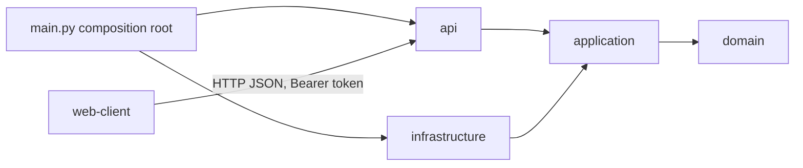
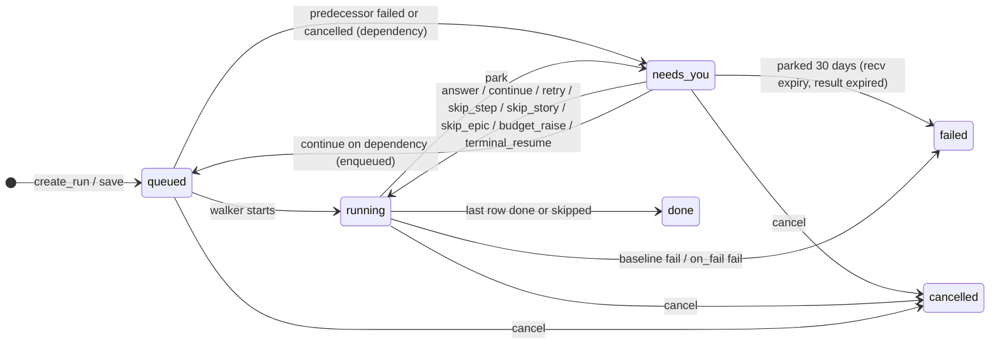
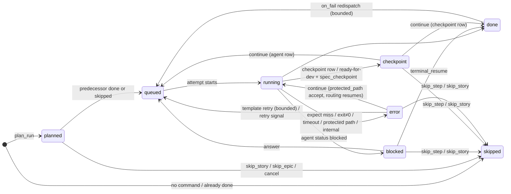
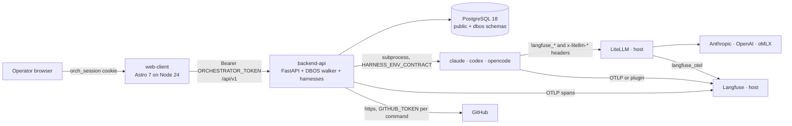
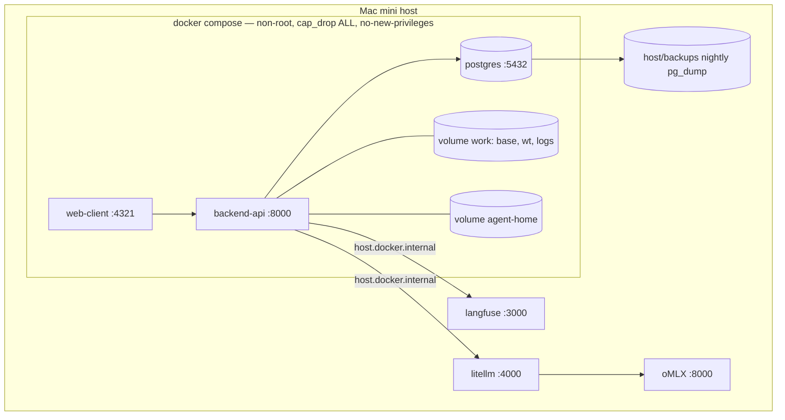
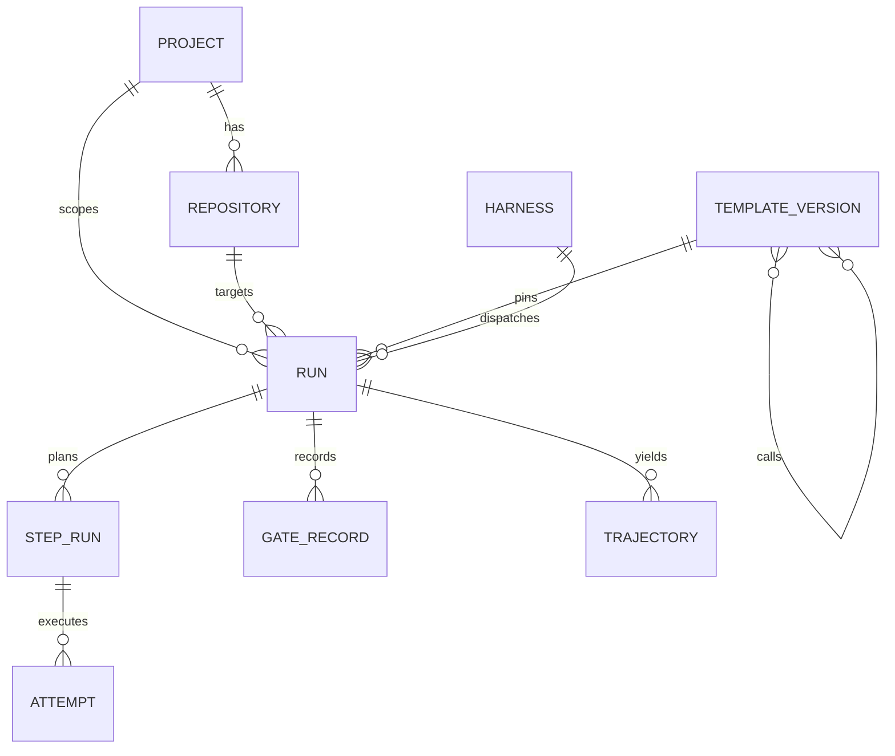

# Architecture Spine — ai-orchestrator-mvp

`[ADOPTED]` marks a decision the PRD, the user, or verified reality had already settled; unmarked ADs bind equally.

## Design Paradigm

**Clean architecture (ports & adapters)** in each deployable, and **one durable interpreter over a materialised plan** as the runtime model: a Run is planned entirely at start into `step_run` rows, then walked by a durable engine that executes one row at a time and parks for humans.

| Layer | backend-api directory | May import |
| --- | --- | --- |
| domain | `src/orchestrator/domain/` — entities, value objects, status machines, port protocols | stdlib (no `os`, `shutil`, `subprocess`), pydantic |
| application | `src/orchestrator/application/` — use cases, step kinds, template validator/planner, routing and budget rules | domain |
| api | `src/orchestrator/api/` — FastAPI routers per feature, request/response schemas, bearer dependency | application, domain |
| infrastructure | `src/orchestrator/infrastructure/` — DBOS engine adapter + walker, SQLAlchemy repositories, git, workspace, process runner, harness adapters, gateway, tracing, crypto, settings | application, domain |
| composition root | `src/orchestrator/main.py` — wires adapters into ports, launches DBOS + uvicorn | everything |

web-client is an **Astro multi-page app with React islands** acting as the browser's only origin (backend-for-frontend): pages, Actions and a proxy route call backend-api server-side; islands never hold a backend credential.

## Invariants & Rules



### AD-1 — Two deployables, one browser-facing origin [ADOPTED]

- **Binds:** all
- **Prevents:** islands calling backend-api directly, CORS, cookies on the API, two auth surfaces
- **Rule:** The deployables are `web-client` and `backend-api` (the orchestrator process and the harness CLIs share the backend-api container). The browser talks only to web-client. web-client's server side is the only caller of backend-api and always sends `Authorization: Bearer $ORCHESTRATOR_TOKEN`; `src/api/server.ts` (server-only, reads `astro:env/server`) and `src/api/client.ts` (browser, base `/api/`) are the only modules that call `fetch`; the proxy route `src/pages/api/[...path].ts` and Actions import `server.ts`. backend-api exposes `/api/v1/*` plus `/openapi.json` and `/healthz`, JSON only, no cookies, no CORS headers. Enforced by eslint `no-restricted-globals`/`no-restricted-imports` on `src/islands/**`, `src/stores/**`, `src/components/**`.

### AD-2 — Dependency direction inside backend-api

- **Binds:** backend-api, every epic
- **Prevents:** DBOS, SQLAlchemy, FastAPI, filesystem or subprocess idioms leaking into use cases; untestable rules
- **Rule:** Imports follow the diagram above and nothing else. `domain/` and `application/` import neither `fastapi`, `sqlalchemy`, `dbos`, `subprocess`, `os`, `shutil`, `httpx`, `langfuse` nor `git`; all I/O goes through the ports in AD-14. Enforced by `import-linter` layer + forbidden contracts in `pyproject.toml`; CI fails on violation.

### AD-3 — The contract is owned by backend-api and generated into web-client

- **Binds:** FR-1..FR-29 (every endpoint), web-client `src/api/`
- **Prevents:** hand-written TypeScript twins drifting from Pydantic
- **Rule:** Pydantic schemas in `api/schemas/` are the single source. `make openapi` exports `contracts/openapi.json`; web-client generates `src/api/schema.d.ts` with `openapi-typescript` and calls through `openapi-fetch`. CI regenerates both files and fails on `git diff --exit-code`; no TypeScript type for an API payload is written by hand.

### AD-4 — One secret token, two carriers [ADOPTED]

- **Binds:** FR-1, NFR-3
- **Prevents:** a second user model, roles, session tables
- **Rule:** `ORCHESTRATOR_TOKEN` (instance env) is the only credential. backend-api authenticates every `/api/v1/*` request by constant-time comparison of the bearer. web-client's `POST /login` compares the same token and sets a signed, HttpOnly session cookie `orch_session` (30 days, signing key `ORCHESTRATOR_SESSION_SECRET`); Astro middleware redirects unauthenticated page loads to `/login`.

### AD-5 — Credentials come from the instance env and stop at the process that needs them [ADOPTED]

- **Binds:** FR-2, FR-11, FR-14, FR-26, NFR-3, PRD §11 privacy
- **Prevents:** tokens in the DB, tokens in agent environments, per-repo credential code
- **Rule:** `GITHUB_TOKEN`, `LITELLM_API_KEY`, `LITELLM_SPEND_KEY`, `LANGFUSE_PUBLIC_KEY/SECRET_KEY`, `ORCHESTRATOR_*` are read once by `infrastructure/settings.py` (pydantic-settings) and nowhere else. Git commands receive `GITHUB_TOKEN` per command via `GIT_ASKPASS`. A harness process receives exactly the `HARNESS_ENV_CONTRACT` (AD-10): gateway URL and `LITELLM_API_KEY`, Langfuse keys and trace env, the Run identifiers, the Project's env vars, and content-logging switches (`OTEL_LOG_USER_PROMPTS`, Codex `log_user_prompt`, plugin equivalents) only when `project.log_prompt_content` is true; never `GITHUB_TOKEN`, never `LITELLM_SPEND_KEY` (the spend-reading key, used only by `infrastructure/gateway/`), never the orchestrator's own env. `LITELLM_API_KEY` is a LiteLLM virtual key of `key_type: llm_api` (model routes only); `LITELLM_SPEND_KEY` is the master key or a `proxy_admin` / `proxy_admin_viewer` key, because `/spend/logs/v2` is row-scoped to the caller's own user otherwise. Project env vars are stored Fernet-encrypted (`ORCHESTRATOR_SECRET_KEY`) and returned masked.

### AD-6 — The durable engine is a port; identifiers are opaque

- **Binds:** FR-12, FR-13, FR-25, NFR-1
- **Prevents:** DBOS tables, ids, or decorators appearing outside `infrastructure/dbos/`; an engine swap touching use cases
- **Rule:** `domain/ports/engine.py` declares `WorkflowEngine` with exactly: `enqueue(run_id, partition_key)`, `signal(run_id, Signal)`, `cancel(run_id)`, `list_queue() -> [QueueEntry{run_id, engine_state ∈ {enqueued, pending}, position: int | None, enqueued_at}]`, `attempt_record(engine_ref) -> EngineRecord | None`, `schedule(name, cron, job)`. `run.engine_ref` and `attempt.engine_ref` are JSON written and read only by the adapter. The adapter is replay-safe: every side effect inside an engine step, side-effecting steps declared with engine retries off (the engine never re-executes on its own), list files read once per Run, no wall-clock branching outside steps; `application_version` is the pinned `DBOS_APPLICATION_VERSION`, bumped deliberately when the walker's step sequence changes, after draining active Runs.

### AD-7 — A Run is planned completely, purely, from the remote branch, before it is enqueued

- **Binds:** FR-8, FR-9, FR-10, FR-23, FR-25, FR-29
- **Prevents:** steps appearing mid-run, two views of "what will run", plans that change on recovery or with a later repository edit, misordered rows
- **Rule:** `plan_run(template_version, inputs, Git) -> Plan{plan_ref, rows: [PlannedRow{seq, path, kind, gate, status, reason?, with_resolved}]}` is pure. It reads every `for_each` list file and callee version through `Git.read_file(ref, path)` / `Git.list_files(ref, prefix)` at `origin/{branch}` when the branch exists, else `origin/{base}`, records that SHA as `plan_ref`, allocates every branch a Template declares a fresh name — the first ordinal `{branch}-{n}` the origin does not already hold, so two Runs of one Template never meet on one branch (`with {mode: attach}` and a `git.submodule` branch are the exceptions, below) — resolves every `{{…}}` from the entity snapshot into `with_resolved`, and expands the pinned tree into rows in traversal order with a dense integer `seq`. A `template` call is a path segment, not a row; `pause_before_item_when` / `pause_after_item_when` become rows of kind `checkpoint` (gate `human`) at `…stories[n].before` / `…stories[n].after`; a `shell` whose resolved command is empty is planned `skipped · no command` — which is what makes a per-epic command field optional: an entry that omits it plans a skipped row, never a plan-time error *(ratified 2026-09-23, hub-Run initiative workflow)*; a `checkpoint` declaring `with {when: <expression>}` whose resolved condition is falsy is planned `skipped · no checkpoint` by the same plan-time rule, so a conditional stop costs no row at run time *(ratified 2026-09-23, multi-repository initiative dispatch)*; a Story whose file is already `done` at `plan_ref` has its frame planned `skipped · already done` unless the Run input `re_review_done` is true. The `git.*` rows carry the allocated name; `plan_ref`, the list-file fallback and pre-flight's held-branch refusal keep asking the origin about the declared one, and a `git.worktree` row starts its fresh branch at the declared branch when the remote holds it and at `base_branch` otherwise, so the worktree holds the tree the plan was read from. A `git.worktree` row declaring `with {mode: attach}` is exempt from allocation: the declared branch is taken by its exact name, `Plan.branches` maps the name to itself, and the executor fetches it so the worktree attaches to that branch's current origin head — how a Run enters a repository's shared integration branch, waived in AD-14 and serialized by AD-12's partition *(ratified 2026-09-23, multi-repository initiative dispatch; post-mortem proposal D)*. A `git.submodule` row declaring `with {workdir, branch}` is exempt from allocation for the same reason and one more: that branch lives in the submodule's own repository, which the allocator — which asks the Run's origin — cannot reason about, so the name is taken exactly and resolved against the submodule's remote when the row executes, never at plan time *(ratified 2026-09-23, hub-Run initiative workflow)*. Item fields are data the Template may consume: a `for_each` entry's fields resolve into `{{item.field}}` expressions whatever they are named (`{{epic.workdir}}`, `{{epic.quality_gate}}`), the validator checks such an expression for grammar and never for the field's existence — by design, since the list file is repository content it cannot see (AD-15) — and a field an entry omits resolves empty, which the empty-command rule above turns into a skipped row rather than an error. A hub Run reads its specs from the hub: `plan_run` reads `epics.yaml`, `stories.yaml` and every callee through `Git.read_file` at the **Run's own** repository, so a member repository's content is never read at plan time and a `workdir` is a string until its step executes *(ratified 2026-09-23, hub-Run initiative workflow)*. `create_run` persists the rows as `step_run` in one transaction before `engine.enqueue`; pre-flight renders the same `plan_run` output without persisting; a plan-time error is a 422 naming template, version, line and item index. The walker executes only existing rows in `seq` order; `path` is the human key. Re-execution is a new `attempt` on the same row, never a new row. The first row of every plan is `plan.check` (path `plan`, gate deterministic): its executor re-reads every list file at the branch head and compares it with its content at `plan_ref`; a difference is `StepResult.park(plan_stale: {file})` (AD-13) — a plan is never silently executed against a changed list, and the park has a row to attach to. `label` (human name, e.g. `epic 1 · story 4-1 · build`) is computed by `plan_run` and stored on `step_run`. PRD `dev-loop` is `initiative@1 → epic@1 → story@1`; the Run input "epics file" is `{initiative_folder}/epics.yaml` (the outer list file, one entry `{id, title, branch, spec_folder, done_checkpoint?}` per epic); `epics.md` is not read. `story@1` has no checkout and is a callee only; every other shipped template is a root `create_run` accepts (`initiative`, `initiative-hub`, `epic`, `repo-init`; `initiative-hub-epic` and `initiative-hub-story` are callees like `story@1`).

### AD-8 — One writer per transition: `apply_step_result` for execution, `signal_run` for the operator

- **Binds:** FR-10, FR-13, FR-16..FR-20, NFR-2
- **Prevents:** routers, executors, the walker, adapters or the UI mutating status; double writes on park; a second status machine in the UI; a third writer for dependent Runs
- **Rule:** `run`, `step_run`, `attempt`, `gate_record` change only through repository ports, in one unit of work per use case, opened by the engine adapter for the step (`SQLAlchemyDatasource`) or by the router for a request. Two use cases own execution writes: `start_attempt(run_id, seq) -> Attempt` (row `queued → running`, new `attempt` with `n`, `started_at`, `engine_ref`; committed in its own unit of work before the executor runs) and `apply_step_result(run_id, seq, StepResult)`, which applies every completion transition and, when the row ends `done | skipped`, moves the successor row `planned → queued` in the same unit of work; the walker calls both inside the engine step that runs the row. The `agent` executor records `start_sha`, `frozen_test_files` and `pgid` through `AttemptRepository.mark_started` in its own unit of work *before* `ProcessRunner.wait`, and `end_sha`, `exit_code`, `session_id`, `usage`, `log_path` through `mark_finished` right after the harness exits, so a restart finds them (FR-12). Step executors otherwise return results and never touch status fields. A `StepResult.park` makes it write `run.status = needs_you`, `run.park_kind`, `run.park_path` and one `gate_record` together (when the row also routed to `blocked | checkpoint` and the budget rule trips, two records are written — the routed stop, then `budget` — and `park_kind = budget`); it is a logged no-op when `run.status ≠ running` (a cancelled Run absorbs late results). Any exception escaping an executor is caught by the walker inside the same step and applied as row `error` (reason `internal: {exception class}`) with `park_kind = internal`. `signal_run(run_id, Signal)` owns every operator transition on the Run and the re-queue of the target row (`run.park_path`): it validates the signal against the current status (409 otherwise), appends the `gate_record`, applies the transition, clears `park_*`, then calls `engine.signal` — except the `start` Signal and `continue` on a `dependency` park, which call `engine.enqueue` instead and leave `after_run_ids` untouched: the Run was never in the engine (AD-12); the walker on wake only reads. Recv expiry is an execution write: the walker applies it through `apply_step_result` with the reserved result `expired` (Run `failed`, reason `parked 30 days`), so its terminal fan-out has the same owner as any other; parks written outside any step (`dependency`) have no `recv` and do not expire — the queue row keeps its reason until the Operator acts. `continue` on a `checkpoint`-kind row moves it to `done`, on an `agent` row to `queued` — the only kind test outside `application/steps/`. Every Run transition appends a `gate_record`; `gate_record.event` is the `Park.kind` for machine stops, the `Signal.kind` for operator actions (the `start` Signal records as `started_by_operator`), plus `start` (execution began), `done`, `failed`, `cancelled`. A terminal transition additionally resolves the Runs whose `after_run_ids` contain this Run **and whose `engine_ref` is still null**, in the same unit of work (AD-12) — dependent resolution belongs to whichever of the two writers applied the terminal status, never to a third; fan-in makes the resolution a read of the dependent's whole predecessor list, not of this Run alone *(ratified 2026-09-23, multi-repository initiative dispatch)*. The UI renders stored tokens; the only derived token is the group status of AD-15.





### AD-9 — Every step kind is one module behind one protocol; executors are pure over ports; re-execution is bounded by the pinned template

- **Binds:** FR-5, FR-9, FR-10, FR-11, FR-14, FR-15, FR-16, FR-17; GUIDELINES §8
- **Prevents:** kind-specific branches scattered through the walker, adapters or UI; silent re-enqueue
- **Rule:** `application/steps/<kind>.py` implements `StepExecutor.execute(ctx: StepContext) -> StepResult` for exactly one kind. `StepContext` = `{row, with_resolved, cwd = run.worktree_path, frame_start_sha, previous_attempt: Attempt | None, attempt, resume_signal: GateRecord | None, ports}`; `StepResult` = `{status, gate, output_ref, park: Park | None, redispatch: Redispatch | None}`. A row of kind `agent`, `git.commit` or `git.push` may declare `with {workdir}` — a repository-relative path that must name an initialized git submodule of the Run's worktree — and then `ctx.cwd` is that folder and the step operates on **that folder's own repository** instead of the worktree root; a `workdir` that does not resolve to an initialized submodule parks `misconfigured: workdir {path} is not an initialized submodule`, never a silent fall back to the root. That is the whole of the hub-Run workflow's mechanism: one Run on a hub repository whose `repos/*` submodules are working folders drives every member repository of a multi-repository initiative sequentially, on the same initiative branch, from specs read at the hub (AD-7, AD-12, AD-14, AD-17) *(ratified 2026-09-23, hub-Run initiative workflow)*. The registry in `application/steps/__init__.py` is the only enumeration of kinds; the validator, planner, graph builder and walker read it. Every worktree side effect of a signal (Answer archive + `## Human Answer`, Retry de-ambiguation archive, skip commit message) is performed by the resumed row's executor reading `resume_signal`, inside the engine step. The `agent` executor commits everything it writes before dispatch — in the `workdir`'s repository when the row declares one (AD-17), at the worktree root otherwise: WIP commit (`wip: story {id} attempt {n} (interrupted)`, only when dirty) → `project-context.md`, Answer archive, `## Verify Failure` → commit `orchestrator: prepare story {id} attempt {n}` (only when something was written) → `attempt.start_sha = HEAD` → dispatch; the harness always starts on a clean tree (`bmad-build-auto` step-01 halts otherwise). On `resume_signal = continue` after a `protected_path` park the `agent` executor does **not** dispatch: it re-applies its tail (protected-path check with `run.accepted_paths` excluded → routing → `Gateway.spend` → budget rule) over `previous_attempt`'s recorded result, on the same attempt number — no new attempt, no new spend; a `git.commit` row parked on `protected_path` re-runs whole on `continue`. Bounded automatic re-execution exists only as `retry {max, prompt}` (expect miss, same row) and `on_fail.redispatch {max}` (verify failure → append `## Verify Failure`, set `in-progress`, new attempt on the target row); each is a recorded `attempt` + `gate_record`, counted on `step_run.retry_count` / `redispatch_count`; exhaustion parks the Run; a redispatch whose target row is `skipped` is applied as `escalate` with reason `re-baseline failed after skip`. `blocked`, budget, timeout, protected-path, merge-conflict, internal and configuration failures are never re-executed automatically. `compose_prompt` in `steps/agent.py` is the only prompt builder; adapters pass it verbatim.

### AD-10 — Harness adapters implement one port, read only environment names from config, never read model output, and are offered only on a passing live Probe

- **Binds:** FR-8, FR-14, FR-16, FR-17, FR-21, FR-33; GUIDELINES §1.6
- **Prevents:** per-harness result parsing; harness flags in application code; per-Run values in shared config files; a stale stored flag standing between the Operator and *Start run*
- **Rule:** `domain/ports/harness.py`: `Harness{name, capabilities{preassign_session, resume, native_tracing}, run(cwd, prompt, env, model, session_id?) -> HarnessResult, resume(cwd, session_id, message, env) -> HarnessResult, resume_command(cwd, session_id), probe() -> ProbeResult{ok, failing_reason?, version, models[]}}` — the adapter's `probe()` shells the script's `probe` verb, so the gate below is reached through the port, never by application code touching a process (AD-2). One adapter per harness in `infrastructure/harness/<name>/adapter.py`. Static config under `AGENT_HOME` is written only by `scripts/harness/<name>.sh` (`install` at image build, `configure` at container start) and references environment variable *names* only (Codex `env_http_headers`, OpenCode `{env:NAME}`, Claude `ANTHROPIC_CUSTOM_HEADERS` from env); adapters write nothing under `AGENT_HOME`. `scripts/harness/_common.sh` is normative: it declares `HARNESS_ENV_CONTRACT` = `{ORCH_RUN_ID, ORCH_ATTEMPT_ID, ORCH_STORY_ID, ORCH_HARNESS, ORCH_PROJECT, ORCH_TAGS, ORCH_LANGFUSE_TAGS, TRACEPARENT, LITELLM_BASE_URL, LITELLM_API_KEY, LANGFUSE_BASE_URL, LANGFUSE_PUBLIC_KEY, LANGFUSE_SECRET_KEY, LANGFUSE_ENVIRONMENT, ORCH_LOG_CONTENT}`, and each `scripts/harness/<name>.sh` declares `HARNESS_ENV_ALIASES` (the harness-native names derived from those, e.g. claude `ANTHROPIC_AUTH_TOKEN=$LITELLM_API_KEY`, `ANTHROPIC_CUSTOM_HEADERS`; opencode `LANGFUSE_BASEURL`, `LANGFUSE_USER_ID`); `env_for(attempt)` populates exactly contract + the harness's aliases + the Project's env vars, and a unit test asserts the adapter's key set equals the two script lists. The container is the sandbox: Codex runs `danger-full-access`, Claude `dontAsk` with `CLAUDE_ALLOWED_TOOLS`, OpenCode config-driven permissions. Adapters return `HarnessResult{session_id, exit_code, usage, log_path}` and nothing interpreted. `resume` delivers into a recorded session only on the parked row itself — template `retry {resume_session}`, and an Answer or Retry Signal with `mode: session` (AD-13); no row ever resumes another row's session; an Attempt's `reply_available` = the harness's `capabilities.resume` ∧ a recorded `session_id` *(ratified 2026-09-15, FR-18/FR-20)*. **Every shipped harness resumes** *(ratified 2026-09-25, step handling — SPEC-step-handling CAP-4)*: `claude --resume {id}`, `codex exec resume {id}`, and `opencode run --session {id}` — the last correcting a `capabilities.resume = False` that had been recorded for `local` on the premise that OpenCode continues no session, which `packages/opencode/src/cli/cmd/run.ts` contradicts at the pinned `OPENCODE_VERSION` itself. A resume names its session id and nothing else: OpenCode's `--continue` guesses the last session of a directory other attempts share, and `--fork` mints a **new** session id, which would break the attempt's spend and trace attribution (AD-11) — neither is ever passed. A session id the harness no longer holds is a reported failure of that attempt (OpenCode: `Session not found`, exit 1), never a silent fresh session. Offering is live *(ratified 2026-09-15, FR-33)*: `probe` — a verb on `scripts/harness/<name>.sh` reusing `doctor`'s checks, exposed as `GET /harnesses/{name}/probe` — verifies CLI present at the pinned version, credentials valid, Gateway reachable, and enumerates the harness's models; `create_run` and pre-flight read the Probe result and a failure is the specific reason (`not logged in`, `gateway unreachable`), never a stored flag; `create_run` rejects a model outside the probed list with 422 naming the list, on every create, not only the form. The form probes on harness selection and on submit — other field changes re-run pure `plan_run` only; `create_run` re-runs the Probe inline once at create, and that result is what "nothing re-probes after" refers to, with one exception: the `start` of a saved Run re-reads the Probe exactly as `create_run` does (AD-13). Queued and parked Runs keep their harness and resume on it. Readiness is the operator-triggered deep diagnostic — persisted state, table `harness{name, enabled, last_readiness_at, failing_check, version_pin}`, an informational badge read by no gate — written only by `use_cases/harness_readiness` (`start(name)` creates the Run; `evaluate(run_id)` is called by the walker's final step for every Run of Project `readiness`; `sync_pins()` runs at container start and resets the badge of a harness whose pinned version changed — the Probe's version check is what refuses a drifted CLI): the badge is green only after an `epic@1` Run on `fixtures/readiness-repo/` (built-in Project `readiness`, uneditable; branch `readiness/{harness}/{date}`, never pushed; an ordinary Run on the Board) reaches `done` **and** the Story file reached `done` (proves subagent tool, file read/write, shell, and skill discovery from a Worktree — the Probe proves none of these) **and** the Run trace holds the attempt's spans (`claude`, `codex`) or generations under the Run session (`local`) **and** `Gateway.spend_for_attempt` returns a non-empty result for that attempt; each check is a line, the first failing one is `failing_check`; the trace check reads `Tracer.attempt_observed(run_id, attempt_id) -> bool`. The fixture is materialised at container start by `scripts/readiness_fixture.sh` (git init + `bmad.install` at `BMAD_VERSION`). `POST /harnesses/{name}/readiness` starts the run; `GET /harnesses` (probe results + badges) feeds New workflow. The Claude adapter additionally passes `--max-budget-usd` = remaining budget, omitted when `budget_usd` is null (AD-11); a harness exit caused by that cap is applied as park `budget`, never as an expect miss.

### AD-11 — One Run, one Langfuse session; parented where the harness allows; every model call attributable to its attempt

- **Binds:** FR-17, FR-26, FR-27, FR-28, NFR-5
- **Prevents:** runs split across unlinked traces; two exporters per harness; spend that cannot be summed per Run or per attempt
- **Rule:** `create_run` creates the Run trace via the `Tracer` port (Langfuse SDK, `trace_id = create_trace_id(seed=run_id)`, `session.id = run_id`, tags `run:`, `project:`) and stores `run.trace_id`. Each attempt runs inside a child span whose W3C `TRACEPARENT` is exported into the harness env. `claude` and `codex` export native OTLP to Langfuse and parent under it; `local` (OpenCode) uses the Langfuse plugin (`LANGFUSE_BASEURL`, `LANGFUSE_USER_ID = run_id`) and is found by user id. Every gateway request carries, from `env_for(attempt)` through the harness's env-name header mechanism, `langfuse_session_id: <run_id>` + `langfuse_tags: [run:, attempt:, story:, harness:, project:]` (traces) and `x-litellm-end-user-id: <run_id>` + `x-litellm-session-id: <attempt_id>` + `x-litellm-tags: run:,attempt:,story:,harness:,project:` (spend logs; all recorded by the open-source proxy). `Gateway.spend_for_attempt(run_id, attempt_id) -> AttemptSpend{usd, tokens_in, tokens_out, provisional}` reads `GET /spend/logs/v2?end_user=<run_id>&session_id=<attempt_id>` with `LITELLM_SPEND_KEY` (never the harness key) and sums; an empty result falls back to `HarnessResult.usage` marked `provisional`, replaced on the next check. It is called after every `agent` attempt (retries included), before verify, writes `attempt.cost_usd`/tokens, and `run.spend_usd` is the sum over attempts; `budget_usd` is optional — null shows `tracked, no cap` and the budget rule is a no-op, tracking itself is untouched and authoritative *(ratified 2026-09-15, FR-17)*; when set, `spend_usd > budget_usd` parks the Run with `park_kind = budget` while the row keeps its routed status, so `budget_raise` resumes at that status (a `blocked` row re-parks as `blocked` at once, without a dispatch). A harness has exactly one exporter. Cost per path is a SQL sum of `attempt.cost_usd` over the path prefix.

### AD-12 — The (Repository, branch) partition is the lock; a saved Run enters the engine only when started [ADOPTED]

- **Binds:** FR-8, FR-13, FR-25
- **Prevents:** a separate lock table, lock release on park, a dependency poller, a second writer for dependent Runs, a new status token for waiting conditions, an initiative's dependency graph living only in comments
- **Rule:** `engine.enqueue(run_id, partition_key = "{repository_id}:{branch}")` — the **declared** branch of the plan's `git.worktree` row (never an allocated fresh name, which by AD-7 cannot collide); an `initiative` plan uses its base branch, and its per-epic branches are guarded by AD-14's held-branch refusal, not by the key *(ratified 2026-09-15, FR-13; formerly `repository_id` — the port's `partition_key` widens to `str`)* — on one queue with global concurrency `MAX_ACTIVE_RUNS` (instance setting, default 2, read at container start; a change is a restart, not a `DBOS_APPLICATION_VERSION` bump) and partition concurrency 1. `engine.enqueue` is idempotent on `run_id`: the adapter derives the workflow identity from `run_id`, so a second enqueue of the same Run is a recorded no-op; the adapter's enqueue participates in the caller's unit of work (the engine shares the database), and container start sweeps the residue of any crash — every Run whose `engine_ref` is null and whose `after_run_ids` is non-empty and wholly `done` is enqueued. The partition and the global slot are held for the Run's whole life, including `needs_you` (PRD FR-13 states the trade-off); a Run whose `engine_ref` is null holds neither, nor its branch (AD-14) *(ratified 2026-09-23, multi-repository initiative dispatch)*. A merge Run declares its repository's integration branch with `mode: attach` (AD-7), so its key is `{repository_id}:{that branch}` and the merges of one repository serialize on it however many epics fan in. Runs on the same Repository but different branches execute concurrently; pre-flight surfaces the shared-repository warning with the facts and *Start run* requires the explicit confirmation (FR-8), never a silent queue. *Save* and `after:` dependencies *(ratified 2026-09-15, FR-8/FR-13 — the F4-wave delta; none of it is in code yet)*: *Save* persists the planned rows and calls no `engine.enqueue` — a saved Run is status `queued` with `engine_ref` null; the null **is** the saved state, no extra flag, no new token (application reads only its *presence*; the content stays adapter-only, AD-6) — and enters the engine on the Operator's `start` Signal (AD-13), or, when `run.after_run_ids` is non-empty, when its predecessors end: the writer applying a Run's terminal transition (AD-8) resolves its dependents (`engine_ref` null only) in the same unit of work — **all** predecessors `done` → `engine.enqueue(dependent)`; **any** predecessor `failed | cancelled` → dependent `needs_you`, `park_kind = dependency`, `park_path` null, gate record, the reason naming that predecessor. `after_run_ids` is a fan-in list (uuid, empty by default), and neither `start` nor `continue` on a `dependency` park clears it *(ratified 2026-09-23, multi-repository initiative dispatch; post-mortem proposal A)*: resolution only ever considers Runs whose `engine_ref` is null, so clearing buys nothing, and the retained edges are the durable record an initiative's DAG is rendered from. `use_cases/queue.list_queue()` joins `engine.list_queue()` with `run`, appends the saved Runs, and returns the FR-25 row with `reason ∈ {branch held by {run}, "global concurrency, held by {runs}", running, waiting for your answer, "waiting for runs {x, …}", saved — not started}` — reason texts, never status tokens; there is no queue state table; the renames from `repository lock held by {label}` / `held by {labels}` revise test-pinned strings and land only as the Operator revision of 2026-09-15 (anchor exception 4), named and dated in the revising story. Pre-flight names the holding Run, and both it and the queue's `branch held by {run}` note read only Runs that are in the engine — a saved Run is never the holder. A multi-repository initiative is reachable as **one** Run on a hub repository whose `repos/*` submodules are working folders — each epic's steps inside its submodule (`with {workdir}`, AD-9), sequentially, all on the same initiative branch taken `mode: attach` in the hub and created-or-checked-out in each submodule by `git.submodule` (AD-14), specs read from the hub at plan time (AD-7) *(ratified 2026-09-23, hub-Run initiative workflow)*. It is template-expressed: it needs no endpoint and no per-Run initiative field — it is an ordinary Run started from `/workflows/new`, and its partition key is the hub's `{repository_id}:{branch}` like any other Run's, which means member repositories are serialized only by the Run being one, and a second Run writing the same submodule is the Operator's to avoid.

### AD-13 — Signals are an enumerated contract that writes the database; worktree effects happen in the resumed step, except cancel

- **Binds:** FR-8, FR-13, FR-16..FR-21
- **Prevents:** endpoints that talk to the engine directly; side effects done twice or never; ad-hoc resume paths; orphaned worktrees and processes
- **Rule:** A use case never blocks; it returns `Park(reason, kind ∈ {blocked, checkpoint, verify_failed, budget, timeout, push_rejected, protected_path, misconfigured, plan_stale, internal, dependency, merge_conflict})` — `push_rejected` also carries `sync: branch diverged`; `misconfigured` also carries `no story file`, `ambiguous story file`, `unexpected status: {s}`, `harness exit {code}`, `gateway unreachable`, `branch held by {run}` (the AD-14 worktree backstop — needs its PRD §4.6 line); `timeout` carries both `stalled {path}: no activity for {n} min` and `timeout {path} after {n} min`; `dependency` (reason `run {x} ended {status}`, `park_path` null) is written outside any step by the predecessor's terminal transition and never expires — no `recv` exists for it (AD-8, AD-12; ratified 2026-09-15); `merge_conflict` (reason `merge conflict: {from} into {branch}`) is written by the `git.merge` executor on a conflicted merge and admits `retry` and `cancel` only *(ratified 2026-09-23, multi-repository initiative dispatch; post-mortem proposal D)*; the PRD §4.6 table is the reason-text and admitted-signal contract — and the engine adapter waits with a single `recv` on `human:{run_id}` (30 days; expiry is applied by the walker as Run `failed`, reason `parked 30 days`). Routers call `signal_run(run_id, Signal)`:

| `Signal.kind` | Valid when | `signal_run` writes | Effects in the resumed engine step | Row transition |
| --- | --- | --- | --- | --- |
| `answer {text, mode: restart \| session}` | `park_kind ∈ {blocked, checkpoint}` on an `agent` row (at a spec checkpoint = *Reject with a reason*); `mode: session` additionally requires the Attempt `reply_available`, else 422 naming the reason | gate_record with text and mode | restart: executor archives the Story file to `stories/.answers/{id}-attempt-{n}.md` with `## Human Answer`, then first-dispatches with the Answer suffix; session: `Harness.resume` delivers the Answer into the recorded session (AD-10) — nothing archived, no re-plan | `blocked → queued` / `checkpoint → queued` |
| `continue` | `park_kind ∈ {checkpoint, protected_path, plan_stale, dependency}` | gate_record (protected_path: the accepted file list) | `agent` row at checkpoint: re-dispatch without the halt suffix; `checkpoint` row: none; `protected_path`: routing resumes on the same tree, no dispatch; `plan_stale`: the recorded plan proceeds; `dependency`: `engine.enqueue` — start anyway, `after_run_ids` retained (AD-12) | `checkpoint → queued` / `→ done`; `error → running → routed status`; `plan_stale`: the `plan.check` row `→ done`; `dependency`: Run `needs_you → queued`, no row changes |
| `retry {text?, mode: restart \| session}` | `park_kind ∈ {timeout, push_rejected, misconfigured, internal, verify_failed, merge_conflict}` or row `error`; `mode: session` additionally requires `reply_available`, else 422. **`mode` defaults to `session` when `reply_available`, else to `restart`** *(ratified 2026-09-25, step handling — SPEC-step-handling CAP-3; formerly unstated, which the implementation resolved as `restart` and so discarded a resumable session by default)*: resume is what Retry means, restart is the Operator's opt-out, and a stop that cannot resume states which of the two reasons — no recorded `session_id`, or a harness without `resume` — put it there rather than restarting silently | gate_record with mode and text | restart: executor archives all-but-newest ambiguous files, then re-runs, **with `text` as the retry prompt in front of the composed dispatch** *(ratified 2026-09-25, step handling — SPEC-step-handling CAP-2)*; on `push_rejected` and `verify_failed` rows a `Git.sync` runs first; on `merge_conflict` the `git.merge` row re-runs whole, aborting any merge in progress first, and a merge the Operator completed and pushed out of band ends `done · already merged`; session: the recorded session resumes with the Operator's instruction, context kept — **`text` is that instruction**, and a Template's own `retry {prompt}` is what stands in when the Operator supplied none, never the reverse | `error → queued` |
| `start` *(ratified 2026-09-15, FR-8/FR-13)* | `engine_ref` null **and** status `queued` (a saved Run; a dependency-parked Run admits only Continue/Cancel) | gate_record (event `started_by_operator`); `engine.enqueue` (AD-12); `after_run_ids` retained *(ratified 2026-09-23)* | none | none; the Run leaves `saved — not started`; it also re-reads the Probe exactly as `create_run` does (AD-10) |
| `skip_step` *(ratified 2026-09-25, step handling — SPEC-step-handling CAP-1)* | `park_path` names a row whose status is `blocked \| checkpoint \| error` — **every** park kind, none excluded, since the Operator decides whether one row is worth skipping and a park kind cannot decide that for them. The two stops it therefore does not reach are the two that park no skippable row: `dependency`, which names no row at all, and a `budget` park taken after a row ended `done` | gate_record; **that row only** `→ skipped (skipped by operator)` | none — no dispatch, no worktree write; the walker resumes at the next row | `blocked \| checkpoint \| error → skipped`, Run `needs_you → running` |
| `skip_story` | `park_kind ∉ {budget, plan_stale, push_rejected, dependency}` and `park_path` inside a story frame | gate_record; every non-terminal `agent`/`checkpoint` row of the innermost `…stories[n]` frame `→ skipped (skipped by operator)`; the frame's `git.commit` message re-resolved to `story {id}: skipped by operator` | the frame's `verify` row runs as the re-baseline, then `git.commit` | as stated |
| `skip_epic` | `park_kind ∉ {budget, plan_stale, dependency}` and `park_path` inside an `epics[i]` frame | every non-terminal row of the remaining story frames of that epic `→ skipped`, plus the current frame's `agent`/`checkpoint` rows and — after `re-baseline failed after skip` — its `error` verify row; the current story's `git.commit` row and the epic's `git.push` / `pr.link` stay planned (marked skipped only when the push itself is the stop) | commit-guard, push and compare link run, then the next epic | as stated |
| `budget_raise {budget_usd}` | `park_kind = budget` and `budget_usd > spend_usd` | `run.budget_usd`, gate_record; when the parked row is `blocked | checkpoint` it rewrites `park_kind` to that status in the same unit of work and does **not** call `engine.signal` (the Run stays `needs_you`, the Question is the earlier gate record) | none | none; when the row is `done` the walker resumes at the next row |
| `cancel` | any non-terminal | gate_record; `ProcessRunner.kill_group(attempt.pgid)`; `engine.cancel`; for each `run.worktrees[]`: `Git.remove_worktree`, `Git.delete_branch` when `created_branch and not pushed` — each effect a recorded no-op when its referent (attempt, engine workflow, worktree) does not exist | none (the walker's late result is absorbed) | `planned/queued → skipped`, Run `→ cancelled` |
| `terminal_start` | `needs_you` and not `terminal_session` | `terminal_session = true`, gate_record (sent by web-client when the command is copied) | none | none |
| `terminal_release` | `terminal_session` | `terminal_session = false`, gate_record | none | none |
| `terminal_resume` | sent by the scheduled job `terminal_poll` after two consecutive clean `done` polls | the `agent` row `→ done` (actor `terminal`), `terminal_session = false`, the successor row `planned → queued`, gate_record | verify runs | `blocked → done`, verify `→ queued` |

A `mode: session` answer or retry *(ratified 2026-09-15, FR-18/FR-20 — IMP-003; not in code yet)* is a **new Attempt on the same row**: `n+1`, `session_id` inherited from the resumed Attempt (that continuity is what "context kept" means), `start_sha = HEAD` at delivery, `env_for` of the new Attempt — so spend, trace, and the AD-17 range all bill to it; `mark_started`/`mark_finished`, the protected-path check, FR-16 routing, `Gateway.spend` and the budget rule run exactly as after a dispatch; the prepare commit is skipped (nothing was written). `Harness.resume` returns a `HarnessResult` like `run` (AD-10).

`Harness.resume_command(cwd, session_id)` is prefixed with `env_for(attempt)` (`env ORCH_RUN_ID=… …`), so a terminal session's gateway calls are attributed to the attempt like any other.

`PUT /runs/{id}/files` (spec folder only, `needs_you` and not `terminal_session`, never `stories.yaml` or `epics.yaml` — the planned list files are read-only, `planned at {plan_ref}`) commits the edit immediately as `spec: operator edit (orchestrator)`; it and `cancel` are the only worktree writes outside an engine step. `terminal_poll` runs every 30 s over Runs with `terminal_session and status = needs_you`.

### AD-14 — All filesystem, git and process side effects go through three ports; one worktree per (Run, branch) [ADOPTED]

- **Binds:** FR-4, FR-9, FR-11, FR-12, FR-15, FR-16, FR-18..FR-20, FR-23, NFR-3
- **Prevents:** shell strings or file I/O in use cases; a harness inheriting the orchestrator's environment; orphaned worktrees when an initiative spans branches
- **Rule:** `Git` port (`ls_remote`, `read_file(ref, path)`, `list_files(ref, prefix)`, `branch_exists`, `clone_base`, `worktree_add`, `sync`, `status`, `diff_names(from_sha)`, `commit`, `push`, `remove_worktree`, `delete_branch`, and *(ratified 2026-09-23, multi-repository initiative dispatch)* `merge` — merge a ref into the current worktree's branch, aborting any merge in progress first — and *(ratified 2026-09-23, hub-Run initiative workflow)* the submodule operations — `submodule_update(worktree)`, the init + update of the Run's worktree's submodules, `submodule_path(worktree, workdir)`, the read-only probe — the initialized submodule that `workdir` names, repository-relative and normalised, or nothing — which reads and mutates no checkout and is what per-dispatch `workdir` verification asks, precisely because `submodule update` in its default checkout mode resets a submodule to the gitlink the hub's index records and so would discard an advanced member checkout *(ratified 2026-09-23, hub-Run initiative workflow — H6 defect fix)*, `submodule_checkout(worktree, workdir, branch, base?)`, create-or-checkout of `branch` inside the submodule at `workdir` with upstream set, cut from `origin/{branch}` when that submodule's remote holds it and from the submodule's current HEAD otherwise, and the `workdir` variants of `commit` and `push`, which run in the submodule's own repository), `Workspace` port (`read`, `write`, `glob`, `exists`, `move`, `tree` — rooted at the Run's current worktree, unavailable before the first `git.worktree` row, path traversal rejected) and `ProcessRunner` port (`start(cmd, cwd, env, timeout_min?, stall_min?) -> {pid, pgid}`, `wait`, `kill_group(pgid)`); both timers live in the `ProcessRunner`, the engine never times a step: `timeout_min` is the wall clock (kill group → row `error`, reason `timeout {path} after {n} min`) — on an `agent` row only when the Template declares it, no default hard kill *(ratified 2026-09-15, FR-10)* — and `stall_min` is the default liveness signal for `agent` rows, passed only by the `agent` executor, never for `shell` or `git.*`. The runner's stall signal is exactly: no mtime change under `cwd` (`.git` included, which covers commits) and no growth of the attempt log for `n` minutes → kill group; `wait` returns a result discriminated `{exited(code) | timed_out | stalled}`, and the `agent` executor composes the park (row `error`, reason `stalled {path}: no activity for {n} min`; template-tunable via `stall_min`, default 30) — the expected-Story-file judgment belongs to the executor's `expect` evaluation, never to the runner. Base clones live at `/work/{project}/{repo}/base` with a detached `HEAD` (so any branch, the default one included, can be added as a worktree), worktrees at `/work/{project}/{repo}/wt/{branch}`, logs at `/work/logs/{run_id}/`, all on the named volume `work`. `git.worktree` adds or reuses `wt/{branch}` (reuse when clean, refuse when dirty — and the cleanliness asked is the worktree's own, `Git.status(ignore_submodules=True)`, since a hub Run advances its members on purpose and never commits the gitlink move, so an advanced submodule is never dirt *(ratified 2026-09-24, hub-Run initiative workflow — H7 defect fix)*), appends `{branch, path, created_branch, pushed: false}` to `run.worktrees[]` if absent, and sets `run.worktree_path` to it; `git.push` sets `pushed` on the matching entry and refuses `branch == repository.default_branch`; `pr.link` appends to `run.compare_urls[]`; a submodule is a working folder inside a worktree, never a second workspace *(ratified 2026-09-23, hub-Run initiative workflow)* — every submodule operation runs under the adapter's existing per-command `GIT_ASKPASS` credential path (AD-5), because a member repository may be private; a harness or `shell` row never receives `GITHUB_TOKEN`, which is **why** submodule materialisation and member-repository pushes are orchestrator step kinds and never template shell commands; a `git.push` declaring `workdir` pushes that submodule's branch to the submodule's own origin, and its refusal of `branch == default_branch` reads the **submodule's** default branch, not the Run Repository's; `run.worktrees[]` tracks the Run's own worktrees only, so a `workdir` push sets no `pushed` flag there and `cancel`'s branch deletion never reaches into a submodule; and the hub Run never commits gitlink pointer moves — the hub-side `git.commit` (no `workdir`) stages the spec folder only, and a submodule pointer is not spec content; pre-flight refuses when the branch a `git.worktree` row of the plan was declared from is held by a worktree **or declared by a `git.worktree` row** of a non-terminal Run **whose `engine_ref` is not null** — planned rows exist from `create_run` (AD-7), so a Run that is in the engine guards its branches before it materialises anything, while a saved Run holds none *(ratified 2026-09-23, multi-repository initiative dispatch)*: it can enter the engine only through `start`, which re-runs exactly these pre-flight lines, or through dependency resolution, where AD-12's partition serializes it against every Run on that branch; the allocated name is fresh by construction, so only the declared one can collide. The executor is the backstop for the residual race: `git.worktree` parks `misconfigured: branch held by {run}` when `wt/{branch}` is registered in another non-terminal Run's `worktrees[]`. A `git.worktree` declaring `with {mode: attach}` (AD-7) shares one branch across Runs deliberately — a repository's integration branch — so the fresh-branch guarantee is waived for those frames and for those only; the `{repository_id}:{branch}` partition is what keeps two Runs from writing it at once, which means the backstop is never reached rather than relaxed *(ratified 2026-09-23, multi-repository initiative dispatch; post-mortem proposal D)*. `repository.clone_check{status, at, output, bmad_version}` is written only by `use_cases/projects.run_clone_check` (project save, `POST /repositories/{id}/clone-check`, scheduled job `clone_check`), which also reads `_bmad/_config/manifest.yaml` at the default branch (`bmad_version` = its version, `missing`, or `outdated` against `BMAD_VERSION`); a failing check never blocks the save; `create_run` returns 409 while it is `failed`; `Git.sync` is a recorded no-op when `rev-parse --abbrev-ref @{upstream}` fails (no upstream); `git.worktree` runs no install of its own — `repository.install_command` is a declared template `shell` row (`run: "{{repository.install_command}}"`), and a repository with no command plans it `skipped · no command` *(ratified 2026-09-27, Operator decision: what a Run executes is readable off its template; supersedes the sentence that ran the install inside the kind, which also double-ran it wherever a template declared a setup row)*; pre-flight's `origin reachable` reads `Git.ls_remote` and writes nothing. Every harness process starts in its own session/process group with the AD-10 env; `attempt.pgid` is recorded before the process is awaited; a re-attempt first kills the recorded group and waits for `.git/index.lock` to vanish. Scheduled jobs: `clone_check` (daily), `worktree_gc` (removes worktrees and logs of terminal Runs after 7 days, iterating `run.worktrees[]`), `terminal_poll` (30 s).

### AD-15 — Templates are immutable versions validated by one function; variables do not inherit; the graph is computed once

- **Binds:** FR-5, FR-6, FR-7, FR-29, FR-34, NFR-6
- **Prevents:** a second parser in TypeScript; a Run resolving a changed callee; a callee reading its caller's scope; graph nodes that do not join to rows
- **Rule:** `application/templates/validate.py` is the single parser/validator and implements exactly the "Template DSL v1 keys" table in the Structural Seed: unknown keys, unbound variables, unknown kinds, nested or multiple `for_each` per file, expressions beyond the grammar, cycles, depth > 3, callee input name/type mismatches, non-literal `version`, `parallel`, `timeout_min`/`on_fail` on `template` are rejected; a missing `gate` is reported as `unvalidated`. Errors carry `{template, version, line, reason}`. A callee sees only its declared `inputs`; item bindings are inputs of type `item`, and their **fields are unchecked by design** — a list entry is repository content the validator cannot see, so `{{epic.workdir}}` and `{{epic.quality_gate}}` are grammar-checked and nothing more, and an omitted field resolves empty (AD-7) *(ratified 2026-09-23, hub-Run initiative workflow)*; entity inputs expose a fixed field whitelist (`project.name`, `repository.url | default_branch | install_command | quality_gate_command | unit_test_command`). `POST /templates/{name}/validate`, `plan_run` and `application/graph.py` call it. Saving creates version n+1; a version pinned by any Run, directly or as a callee, is frozen. `graph.py` produces `{nodes, edges, groups, statuses?}` for `GET /templates/{name}/{v}/graph` (node id = template-relative path without indices, e.g. `stories.story.build`; callee calls collapsed) and `GET /runs/{id}/graph` (node id = `step_run.path`, group id = path prefix); group status is computed only there by one rule — `error | blocked | checkpoint` if any row is; else `running` if any; else `skipped` when all are `skipped`; else `done` when all are `done | skipped`; else `queued | planned`. The template graph is index-free with loops unexpanded and calls collapsed; the run graph is the expanded rows. Every node carries `step_run.label` beside `path`; cards and strips show `label`, the Steps table and gate record show `path`. A cancelled Run's group tokens are not derived; the Run token `CAN` wins. web-client lays out with `@dagrejs/dagre` and renders SVG, read-only, embedded in the Run detail — the standalone `?view=diagram` surface is retired and redirects there *(ratified 2026-09-15, FR-29)*. The diagram maps **stored tokens** to the FR-29 border-colour dialect — `done`→green, `running`→blue (`signal-criterion`, revived for exactly this surface), `error`→red, `blocked | checkpoint`→amber, `planned | queued`→grey, `skipped | cancelled`→faint grey, never green (NFR-6's one-signal-per-surface rule is exempted here, colour-never-alone is not) — and derives nothing new: loop iterations render as one group box per path prefix (`epics[0]`, `epics[0].stories[2]`) whose token and border carry the group-status rule above; `graph.py` computes each group's `k/n steps` into the `groups` payload — `k` = rows `done`, `n` = rows not `skipped`, and an all-`skipped` group shows no count; expansion is one level per click, never hover. A leaf node navigates to the Step-run detail (FR-34) at `/workflows/:runId/steps/{path}` with the Path in **dot-index form** (`epics.0.stories.3.build`); one web-client util owns the bracket ↔ dot-index bijection, encode and decode in the same module — the API accepts and returns canonical bracket Paths, never dot-index, and `validate.py` rejects an all-digit step `id`, which would break the bijection.

### AD-16 — BMAD lives in the image and in `_bmad/`; skill folders are never committed

- **Binds:** FR-8, FR-14, FR-15
- **Prevents:** per-run installs; skill folders in target repositories; version skew between skills and scripts; a skill-name collision resolved by copy order
- **Rule:** The backend-api image pins one `bmad-method` version and copies the skill stubs **and the operator-authored skills in the repository-root `ia-agents-skills/`** (a folder to be created) into `~/.claude/skills` and `~/.agents/skills` (read by claude / codex+opencode) at image build *(ratified 2026-09-15, FR-14: the `skill:` dispatch form resolves against exactly these installed folders; a change to `ia-agents-skills/` ships by image rebuild, never per Run; the image build **fails** on a name collision between the stub set and `ia-agents-skills/` and writes `skills-manifest.json` — the union, per harness home; the `SkillCatalog` port exposes that manifest read-only, and pre-flight's installed-skill check reads exactly it, so `validate.py` stays pure)*; a target repository commits `_bmad/` (config, scripts, `custom/`) and its spec folders only, and git-ignores `.claude/skills/bmad-*`, `.agents/skills/bmad-*` and `.opencode/commands/bmad-*`. Pre-flight requires `_bmad/` at `plan_ref` with `_bmad/_config/manifest.yaml` version equal to `BMAD_VERSION`, except for a plan that contains a `bmad.install` row (`repo-init@1`) and a plan that dispatches no skill (no `agent` row with a `skill:`) — own-text dispatches never read `_bmad/`, so the version cannot matter to them; both are a `skip` line *(Operator request 2026-10-30, preflight line 9)*; `repository.clone_check.bmad_version` (default branch) is informational on the Repository row, `plan_ref` decides. The shipped template `repo-init@1` initialises or updates a repository (worktree `chore/bmad-init-{n}` → `bmad.install` → gitignore → commit → push → compare link).

### AD-17 — Frozen anchors are checked deterministically after every agent attempt, against a SHA taken after the WIP commit

- **Binds:** FR-10, FR-16, NFR-2; GUIDELINES §2.5.2, §2.5.4
- **Prevents:** an agent editing the spec, the constitution or existing tests to make a gate pass; operator edits false-parking; a vacuous commit-guard check
- **Rule:** Protected paths per Run: `{spec_folder}/SPEC.md`, `{spec_folder}/stories.yaml`, `{initiative_folder}/epics.yaml`, every `AGENTS.md` (creating one is a hit), and every file matching `repository.test_globs` (default `tests/**`, `**/*.test.*`, `**/*.spec.*`) that existed at the **story frame's first attempt** (`Git.list_files(frame_first_start_sha, …)`, recorded on the frame's first `attempt`); files the agent added inside the frame stay editable on its later attempts; modifications and deletions of the frozen set are hits. Every check covers **agent ranges only**: `attempt.start_sha` is HEAD after the WIP and prepare commits (AD-9), `attempt.end_sha` is HEAD when the harness exits (both recorded by `mark_started` / `mark_finished`, AD-8), and `rules/protected_paths.check(diff_names(start_sha, end_sha) ∪ uncommitted)` never sees an operator `spec: operator edit` or an orchestrator commit. It runs in the `agent` executor after the harness exits and before routing (hit → `status: error, park: protected_path`, reason lists the files), and in the `git.commit` executor over the union of the frame's agent ranges plus the uncommitted tree. Files in `run.accepted_paths[]` (written by `continue` on `protected_path`, with the attempt) are excluded from every later check in the same story frame; the list is copied into `gate_record` and `trajectory`. The frozen test set is `frozen_test_files` of the frame's lowest-`n` attempt that has a `start_sha`. A hit is never re-executed automatically.

When an `agent` row declares `workdir` (AD-9), one attempt spans **two trees and both are checked** *(ratified 2026-09-23, hub-Run initiative workflow)*. In the workdir's repository: `attempt.start_sha` / `end_sha`, the WIP and prepare commits, `frozen_test_files`, and the deterministic protected-path check, with `repository.test_globs` applied to workdir-relative paths, so a submodule's own `tests/**` is what is frozen for that frame. At the Run worktree root, over the same attempt: the hub anchors — `{spec_folder}/SPEC.md`, `{spec_folder}/stories.yaml`, `{initiative_folder}/epics.yaml`, every `AGENTS.md`, and the hub's own frozen test files — checked over the root's agent range, recorded on the attempt beside the workdir pair as `root_start_sha` / `root_end_sha` (the worktree root's HEAD at the same two moments) union the root's uncommitted tree, which keeps "agent ranges only" exact in both trees. A workdir agent that edits a hub test file or a hub anchor is a hit; so is a hub agent (no `workdir`) that edits a file inside a submodule — the root range reports the gitlink, and `Git.status` of each initialized submodule — enumerated read-only, never through `submodule_update`, which writes (AD-14, H6) — reports that submodule's own files, so the check reads submodule-relative paths instead of stopping at the pointer. Either tree's hit parks `protected_path` with the offending paths named in the tree they were found in, and `run.accepted_paths[]` excludes by the same spelling.

### AD-18 — Tests are layered, fakes are shared, and the gates are checkable

- **Binds:** all epics; GUIDELINES §1.6, §1.7, §5
- **Prevents:** unit tests needing Postgres or a harness; each epic inventing its own doubles; E2E suites coupled to each other; a "TDD" rule nobody can check
- **Rule:** Backend unit tests use only in-memory implementations of the ports, one fake per port in `tests/unit/fakes/`, and drive use cases directly. `tests/e2e/` hits a running compose stack over HTTP (httpx scenarios + Schemathesis from `/openapi.json`). web-client: Vitest for units, Playwright in `tests/e2e/` against `astro preview` with backend-api stubbed by route handlers or the real stack (`E2E_BACKEND=real`). Checkable gates: every `src` module has a test module; `domain/` and `application/` rules (`rules/`, `steps/agent.py`, status machines, `signal_run`, `apply_step_result`) have 100 % branch coverage; changed lines ≥ 90 % covered; CI order lint → unit → e2e-api → e2e-ui. "Tests first" is the working convention of `bmad-build-auto`, stated in AGENTS.md and reviewed, not machine-enforced.

### AD-19 — Trajectory capture is a table, written once per done Story

- **Binds:** FR-16, FR-28; GUIDELINES §10
- **Prevents:** a filesystem write path; records edited later
- **Rule:** When a Story's `build` row is `done` and its `verify` row is `done` or `skipped`, `record_trajectory` inserts one append-only `trajectory` row (run, story, harness, model, agent attempts, gate results, cost, story-file snapshot, start SHA → end SHA). `GET /projects/{id}/trajectories.jsonl` exports; nothing updates or deletes rows.

### AD-20 — Configuration is the environment; `.env.example` is its contract

- **Binds:** NFR-4, NFR-7; every deploy
- **Prevents:** config files with divergent keys per component; secrets in compose files
- **Rule:** Both components read configuration only from environment variables through one typed settings module (`pydantic-settings` / `astro:env`). `.env.example` at the repo root lists every variable with a comment; adding a variable without updating it fails `make lint`. Harness config files under `AGENT_HOME` are generated by `scripts/harness/<name>.sh configure` from the same variables at container start, never edited by hand. Host-side LiteLLM (`model_list`, `LITELLM_OTEL_V2=true` + `langfuse_otel` callback, local models as `openai/<alias>` with `use_chat_completions_api: true`) and oMLX are documented in `host/README.md` + `host/litellm.config.yaml`, outside compose.

## Consistency Conventions

| Concern | Convention |
| --- | --- |
| Routes | `/api/v1/<feature>` per feature router: `projects`, `repositories`, `templates`, `runs`, `steps` (served by `routers/history.py`), `queue`, `harnesses` — bearer auth lives in `api/deps.py`, login is web-client-side (AD-4); `/healthz`, `/openapi.json` unversioned. Repository actions: `POST /repositories/{id}/clone-check`, `POST /repositories/{id}/init` (starts `repo-init@1`). Harnesses: `GET /harnesses`, `GET /harnesses/{name}/probe` (AD-10), `POST /harnesses/{name}/readiness`. Trajectories: `GET /projects/{id}/trajectories.jsonl`. Actions on a Run: `POST /runs/{id}/signals {kind, payload}` (AD-13). Worktree files: `GET /runs/{id}/files?path=`, `PUT /runs/{id}/files`. Attempt log: `GET /runs/{id}/attempts/{attempt_id}/log` with cursor paging (FR-34). Activity: `POST /runs/{id}/activity {focused_seconds}` batched every 60 s into `run.active_seconds`, `run.last_opened_at`. |
| Read models | Every screen reads one endpoint shaped for it (`GET /runs?view=board`, `GET /runs/{id}` with steps, stories strip, cost block, gate record, worktrees, compare URLs; `GET /queue`; `GET /steps`); the UI performs no joins or aggregation across endpoints. |
| Ids & keys | UUIDv7 (`uuid.uuid7()`) for every entity; `step_run.seq` orders, `step_run.path` names; engine ids only inside `engine_ref`. |
| Dates & money | ISO 8601 UTC with `Z`; DB `timestamptz`. Money `numeric(12,6)` USD, JSON as string; tokens as integers; local models cost `0` with tokens. |
| Errors | RFC 9457 `application/problem+json` `{type, title, status, detail, instance, errors?}`; validation errors list `{template?, version?, line?, path?, reason}`; 401 bad token, 409 signal invalid for the current status or clone check failed, 422 validation and plan-time errors. |
| Form errors (web-client) | Actions return `ActionError` carrying the problem body; the page re-renders with every submitted value and prints `detail` verbatim plus `errors[]` beside the field named by `path`; no toast, no redirect on error. |
| Lists | `{items: [...], next_cursor: str \| null}`; filters as query params; no envelopes elsewhere. |
| Status tokens | Run `queued running needs_you done failed cancelled`; Step `planned queued running done blocked checkpoint error skipped`; UI tokens `QUE RUN BLK CHK DON ERR CAN SKP`; `needs_you` renders `BLK` or `CHK` from `run.park_kind`. `skipped`, `unvalidated`, `liveness` are words; only `deterministic` or `human` gates may render green. |
| Template variables | `{{name}}` / `{{name.field}}` substitution only; `inputs` are the whole scope of a template; conditions (`pause_*_when`, `escalate_when`) are a single item field or `output.status == <token>`. |
| Naming | Python `snake_case`, modules singular by concept; TypeScript `camelCase`, components `PascalCase.tsx` in `src/islands/` (interactive) and `src/components/` (Astro, static); stores in `src/stores/`; step kinds dotted lowercase. |
| Logging | `structlog` JSON to stdout; every line inside a Run carries `run_id`, `path`, `attempt`; harness stdout/stderr to `attempt.log_path`. |
| Time | `Clock` port in domain; no `datetime.now()` outside infrastructure. |
| Front-end data | Islands poll through the Astro proxy on a single `nanostores` interval store (5 s while any Run is running, else 30 s); state swap without animation; a failed fetch renders the full-surface readout with the failed request and a retry control (FR-24). |
| UI signal & voice | NFR-6/NFR-8 as written, plus: exactly one element per card or row carries a signal colour (green running, amber needs you, red failed); a screen with nothing needing the Operator has no amber or red pixel; copy names the mechanism whenever an action changes a file or branch. Visual tokens: `DESIGN.md`; surfaces: `EXPERIENCE-v1.md`. |
| Front-end auth | Cookie `orch_session`, signed with `ORCHESTRATOR_SESSION_SECRET`; middleware `src/middleware.ts` guards every page except `/login`. |
| Commits & branches | Conventional commits; orchestrator commits `story {id}: {title} (orchestrator)`, `story {id}: skipped by operator`, `wip: story {id} attempt {n} (interrupted)`, `orchestrator: prepare story {id} attempt {n}`, `spec: operator edit (orchestrator)`; repo-init branch `chore/bmad-init-{n}`, `n` the first ordinal free on the origin (AD-7); readiness branch `readiness/{harness}/{date}`. |
| Terminal resume | `docker compose exec backend-api <harness resume …>`. |
| Environments | One environment: the Mac mini compose stack. Local development is the same compose file with `.env` pointing LiteLLM and Langfuse at `localhost`. |
| Operations | Nightly `pg_dump` of the whole database (schemas `public` + `dbos` together) by a host cron to `host/backups/`, 14 days kept; `work` logs and worktrees removed by `worktree_gc`; `agent-home` is not backed up (sessions may be lost, PRD §5). Migrations run at container start (`alembic upgrade head`) before `DBOS.launch()`. |
| Code quality | Python: ruff (lint+format), mypy strict on `domain/` and `application/`, import-linter; TypeScript: eslint (+ the AD-1 restrictions) + prettier + `tsc --noEmit` + `astro check`; both in `make lint`. |

## Stack

| Name | Version |
| --- | --- |
| Python | 3.14 |
| uv | 0.12.9 |
| FastAPI | 0.141.1 |
| Pydantic / pydantic-settings | 2.13.5 / 2.15.0 |
| SQLAlchemy / psycopg / Alembic | 2.0.52 / 3.3.5 / 1.19.1 |
| dbos | 2.31.0 |
| langfuse (Python SDK) | 4.15.1 |
| structlog / PyYAML / cryptography | 26.1.0 / 6.0.3 / 50.0.1 |
| pytest / pytest-asyncio / pytest-cov / httpx / schemathesis | 9.1.1 / 1.4.0 / 7.1.0 / 0.28.1 / 4.25.2 |
| ruff / mypy / import-linter | 0.16.5 / 2.3.1 / 2.14 |
| Node.js / pnpm | 24 (LTS line, image `node:24-bookworm-slim`) / 11.25.0 |
| Astro / @astrojs/node / @astrojs/react / @astrojs/check | 7.2.10 / 11.1.5 / 6.0.5 / 0.9.10 |
| React / nanostores / @nanostores/react | 19.2.8 / 1.5.2 / 1.1.0 |
| openapi-typescript / openapi-fetch | 7.13.0 / 0.17.0 |
| @codemirror/state / view / lang-yaml | 6.7.2 / 6.43.10 / 6.1.3 |
| @dagrejs/dagre | 3.1.1 |
| Vitest / @playwright/test | 4.1.11 / 1.62.1 |
| PostgreSQL | 18 (image `postgres:18`) |
| LiteLLM (host) / Langfuse (host) | 1.99.0 / v4.27.0 |
| @langfuse/opencode-observability-plugin | 0.3.0 |
| bmad-method | 6.11.0 |
| Claude Code / Codex CLI / OpenCode | 2.1.258 / 0.152.1 / 1.18.26 |
| Docker base images | python:3.14-slim-trixie, node:24-bookworm-slim |

## Structural Seed







Fields that carry an invariant (other fields follow the PRD glossary): `project.env_vars_enc`, `log_prompt_content` (AD-5); `repository.default_branch`, `install_command`, `quality_gate_command`, `unit_test_command` (stored, unused), `test_globs`, `clone_check{status, at, output, bmad_version}` (AD-14, AD-17); `harness{name, enabled, last_readiness_at, failing_check, version_pin}` (AD-10; an informational badge — read by no gate); `template_version.yaml`, `hash`, `calls[]`, frozen once pinned (AD-15); `run.engine_ref` (null = saved, AD-12), `plan_ref`, `after_run_ids` (uuid list, empty by default — fan-in, AD-12), `accepted_paths[]`, `worktree_path` (current), `worktrees[]{branch, path, created_branch, pushed}`, `compare_urls[]`, `trace_id`, `budget_usd` (nullable — `tracked, no cap`, AD-11), `spend_usd`, `manual_estimate_h` (immutable after start), `park_kind`, `park_path` (null on a `dependency` park), `terminal_session`, `re_review_done`, `active_seconds`, `last_opened_at` (AD-6, AD-7, AD-11, AD-13, AD-14); `step_run.seq` (dense, orders), `path` (unique per Run), `label`, `kind`, `gate`, `status`, `reason`, `with_resolved`, `retry_count`, `redispatch_count` (AD-7..AD-9); `attempt` — one per execution of any row — `n`, `started_at`, `ended_at`, `status`, `engine_ref`, `start_sha`, `end_sha`, `root_start_sha`, `root_end_sha` (the worktree root's range, written only when the row declares `workdir`; AD-17), `frozen_test_files` (first attempt of a story frame only), `log_path`, and for `agent` rows `harness`, `model`, `session_id`, `pgid`, `exit_code`, `tokens_in/out`, `cost_usd` (AD-10, AD-11, AD-14, AD-17); `gate_record.event` (AD-8); `trajectory` append-only (AD-19).

**Template DSL v1 keys** (the set `validate.py` accepts):

| Level | Key | Type | Notes |
| --- | --- | --- | --- |
| template | `name`, `version`, `description`, `inputs`, `steps` | string, int literal, string, map, list | `inputs.<name>: {type: project \| repository \| string \| path \| enum \| number \| item, required?, default?, values?}` |
| step | `id`, `uses` xor `run`, `with`, `gate`, `timeout_min`, `on_fail` | slug, kind / command string, map, `liveness \| deterministic \| human`, int, `escalate \| fail \| continue \| {redispatch, max}` | `gate` missing → `unvalidated`; `timeout_min`, `on_fail` rejected on `template` |
| step `uses: agent` | `with` declares exactly one dispatch form *(ratified 2026-09-15, FR-5/FR-14)*: `skill` (a string, as shipped `story.yaml`'s `with {skill, args?, prompt_extra?}` already does) **or** `prompt` / `prompt_file`; plus `prompts {dispatch, rendered, answer, halt}` — the Template's own prose, `{{ }}`-resolved at plan time with single-brace runtime tokens (`{skill}`, `{spec_folder}`, `{story_id}`, `{intent}`, `{path}`, `{condition}`, `{answer}`) filled at dispatch *(ratified 2026-09-27, Operator decision: the orchestrator sends no words a template did not write; `compose_prompt` fills and joins, never authors)* — `expect {files: [glob], success: [token], blocked: [token], checkpoint: [token], misconfigured_when: [sentence]}` — the row's declared result contract, free-form tokens, routed by `rules/routing.py` with `success=[done] blocked=[blocked] checkpoint=[ready-for-dev]` as the default for a row that declares no lists; `status_in` stays accepted, validated and unconsulted (deprecated), as does `escalate_when` *(ratified 2026-09-27, same decision)* — `retry {max, prompt, resume_session?}`, `pause_when`, `stall_min` | | zero own-text dispatch forms with `skill` present requires `prompts.dispatch` and `prompts.rendered`; more than one own-text form (`prompt` beside `prompt_file` included), or `prompts.dispatch`/`prompts.rendered` beside an own-text form, is a validation error; `pause_when` requires `prompts.halt`; a token in two routing lists is a validation error; `prompt_file` is read from the working folder; every form goes through `compose_prompt` (AD-9) and carries `expect`; each `files` glob must match exactly one file; `resume_session` defaults true and falls back to a new session when the harness lacks `resume` |
| step `uses: git.submodule` *(ratified 2026-09-23, hub-Run initiative workflow)* | `with` bare or `{update: true}`, **xor** `{workdir, branch, base?}` | — / path + branch names | the two forms are told apart by their keys; keys of both forms together, or `workdir` without `branch`, is a validation error |
| step `uses: agent \| git.commit \| git.push` *(ratified 2026-09-23, hub-Run initiative workflow)* | `with {workdir}` | path, repository-relative | optional; the step runs in that folder's own repository (AD-9), which must be an initialized submodule at execution — the validator checks the path's shape, never its existence |
| step `uses: template` | `with {name, version, inputs}` | | callee inputs checked by name and type |
| for_each | `for_each`, `as`, `steps`, `pause_before_item_when`, `pause_after_item_when`, `parallel` | list-file path, name, list, item field, item field, rejected | one per file, no nesting |

**Shipped kinds** (`application/steps/`):

| Kind | Gate | Default `timeout_min` | Behaviour |
| --- | --- | --- | --- |
| `plan.check` | deterministic | 5 | first row of every plan; list files at the branch head vs `plan_ref` → park `plan_stale` (AD-7); Story-file statuses are deliberately not re-checked — a Story `done` since planning lands as `misconfigured: unexpected status` (accepted exposure of deferred starts) |
| `git.worktree` | deterministic | 5 | AD-14; opens the worktree and nothing else — the install is a declared template row *(ratified 2026-09-27)*; `with {mode: attach}` takes the declared branch by its exact name at its origin head (AD-7) |
| `git.sync` | deterministic | 5 | fetch + `pull --ff-only`; recorded no-op when the branch has no upstream; non-fast-forward → park `push_rejected` (`sync: branch diverged`) |
| `git.merge` | deterministic | 5 | `with {from}`; merges `origin/{from}` into the current worktree's branch with `--no-ff`; conflict → park `merge_conflict` (AD-13); already contained → `done · already merged` |
| `shell` (`run:`) | deterministic | 30 | command in the worktree with the Project env; empty → planned `skipped` |
| `agent` | liveness | — (stall detector, default 30; `timeout_min` only when declared) | protected-path check of the previous attempt → WIP commit → `project-context.md` + signal writes → prepare commit → `start_sha` → `compose_prompt` → dispatch → protected-path check → FR-16 routing → `Gateway.spend` → budget rule; `with {workdir}` runs the whole sequence in that submodule's repository while the hub anchors stay checked at the worktree root (AD-9, AD-17) |
| `git.submodule` | deterministic | 10 | AD-14; two forms, told apart by its `with` keys: bare or `{update: true}` → init + update of the Run worktree's submodules; `{workdir, branch, base?}` → create-or-checkout `branch` inside the submodule at `workdir`, upstream set, cut from `origin/{branch}` when that submodule's remote holds it and from the submodule's current HEAD otherwise. Both go through the Git port's credential path (a submodule may be private, AD-5); the branch is taken by its exact name, never allocated (AD-7) |
| `git.commit` | deterministic | 5 | commit-guard (spec folder staged first), `frame_start_sha` protected-path check; `with {workdir}` commits in that submodule's own repository instead (AD-9) |
| `git.push` | deterministic | 5 | refuses default branch; rejected push → park `push_rejected`; `with {workdir}` pushes the submodule's branch to the submodule's own origin, and the default-branch refusal reads the submodule's default branch (AD-14) |
| `pr.link` | liveness | 5 | compare URL appended to `run.compare_urls[]` |
| `checkpoint` | human | — | parks `checkpoint`; `continue` → `done`; `with {when}` resolving falsy → planned `skipped · no checkpoint` (AD-7) |
| `template` | — | — | path segment; not a row |
| `bmad.install` | deterministic | 30 | `npx bmad-method@$BMAD_VERSION install --yes --directory <worktree>` + gitignore lines |

```text
ai-orchestrator/
  AGENTS.md                      # constitution for agents working on this repo
  Makefile                       # test · e2e-api · e2e-ui · lint · openapi · up · down
  docker-compose.yml             # web-client, backend-api, postgres; volumes work, agent-home; hardening flags
  .env.example                   # every variable of both components (AD-20)
  contracts/openapi.json         # exported by backend-api, consumed by web-client (AD-3)
  templates/                     # shipped Template YAML: repo-init.yaml, story.yaml, epic.yaml, initiative.yaml,
                                 #   initiative-hub.yaml, initiative-hub-epic.yaml, initiative-hub-story.yaml (the hub-Run path, AD-9/AD-12/AD-14)
  scripts/harness/{_common,claude,codex,opencode}.sh   # install · configure · doctor per harness; HARNESS_ENV_CONTRACT + HARNESS_ENV_ALIASES (AD-10, AD-20)
  scripts/readiness_fixture.sh   # materialises fixtures/readiness-repo/ as a git repo with _bmad/ at BMAD_VERSION (AD-10)
  fixtures/readiness-repo/       # one-story repository run through epic@1 by the harness readiness run (AD-10)
  host/                          # README.md, litellm.config.yaml, backups/ (AD-20, Operations)
  backend-api/
    AGENTS.md
    Dockerfile                   # python:3.14-slim + uv + node 24 + git/gh + claude/codex/opencode + bmad-method; non-root `agent`
    pyproject.toml               # deps, ruff, mypy, import-linter contracts
    alembic/
    src/orchestrator/
      domain/                    # entities, statuses, ports/{engine,harness,git,workspace,process,gateway,tracer,clock,repositories}.py
      application/               # use_cases/{create_run,plan_run,start_attempt,apply_step_result,signal_run,preflight,projects,templates,queue,harness_readiness,record_trajectory}.py
                                 # steps/<kind>.py, templates/{validate,plan}.py, graph.py, rules/{routing,budget,protected_paths}.py
      api/                       # routers/<feature>.py, schemas/, deps.py (bearer auth)
      infrastructure/            # dbos/, db/, git/, workspace/, process/, harness/<name>/, gateway/, tracing/, crypto/, settings.py
      main.py
    tests/unit/{fakes,domain,application,api}/
    tests/e2e/
  web-client/
    AGENTS.md
    Dockerfile                   # node:24 build → astro node standalone
    astro.config.mjs             # output: 'server', adapter node standalone, react()
    src/pages/                   # login, index (board), workflows/[id], workflows/[id]/steps/[...path] (FR-34), workflows/new, runs, projects, templates
    src/pages/api/[...path].ts   # proxy → backend-api with bearer (AD-1)
    src/middleware.ts            # cookie guard
    src/actions/                 # form posts
    src/islands/                 # Board, RunDetail, Diagram (shared SVG renderer), RunDiagram, TemplateDiagram, StepDetail (FR-34), RunsQueue, RunsHistory, TemplateEditor, ProjectForm, NewWorkflow (React)
    src/components/              # static Astro components (instrument-dark tokens)
    src/stores/                  # nanostores: polling, session, filters
    src/api/{schema.d.ts,client.ts,server.ts}
    tests/unit/  tests/e2e/
```

| Variable | Used by | Meaning |
| --- | --- | --- |
| `ORCHESTRATOR_TOKEN` | both | the one credential (AD-4) |
| `ORCHESTRATOR_SESSION_SECRET` | web-client | cookie signing key |
| `ORCHESTRATOR_SECRET_KEY` | backend-api | Fernet key for Project env vars |
| `BACKEND_API_URL` | web-client (server) | `http://backend-api:8000` |
| `DATABASE_URL` | backend-api | `postgresql+psycopg://…` (app + DBOS system DB) |
| `DBOS_APPLICATION_VERSION` | backend-api | pinned walker version (AD-6) |
| `GITHUB_TOKEN` | backend-api git only | push/clone (AD-5) |
| `LITELLM_BASE_URL`, `LITELLM_API_KEY`, `LOCAL_MODELS` | harness env, gateway adapter | gateway; `LITELLM_API_KEY` can only call models (AD-5) |
| `LITELLM_SPEND_KEY` | backend-api `infrastructure/gateway/` only | reads `/spend/logs/v2` (AD-11); never in a harness env |
| `MAX_ACTIVE_RUNS` | backend-api | global queue concurrency (AD-12), default 2 |
| `LANGFUSE_BASE_URL`, `LANGFUSE_PUBLIC_KEY`, `LANGFUSE_SECRET_KEY`, `LANGFUSE_ENVIRONMENT` | backend-api, harness env (OpenCode plugin spells it `LANGFUSE_BASEURL`) | tracing (AD-11) |
| `BMAD_VERSION`, `CLAUDE_CODE_VERSION`, `CODEX_VERSION`, `OPENCODE_VERSION`, `LANGFUSE_OPENCODE_PLUGIN_VERSION` | image, pre-flight | pins (AD-16) |
| `CLAUDE_ALLOWED_TOOLS` | claude adapter | PRD §8 Q1 |
| `WORK_DIR` (`/work`), `AGENT_HOME`, `TEMPLATES_DIR` (`../templates` dev, `/app/templates` image) | backend-api | volumes |
| `LOG_PROMPT_CONTENT_DEFAULT`, `LOG_LEVEL` | backend-api | FR-2 default, logging |
| `LITELLM_OTEL_V2=true`, `LANGFUSE_*` | host LiteLLM | `langfuse_otel` callback (host/README.md) |

## Capability → Architecture Map

| Capability / Area | Lives in | Governed by |
| --- | --- | --- |
| FR-1 token login | web-client `pages/login`, `middleware.ts`; backend `api/deps.py` | AD-1, AD-4 |
| FR-2..FR-4 projects, repositories, clone check (incl. `bmad_version`), daily re-check | `use_cases/projects.py`, `infrastructure/git`, scheduled job `clone_check` | AD-5, AD-6, AD-14 |
| FR-30 repository initialisation | `POST /repositories/{id}/init` → `create_run(repo-init@1)`, `steps/bmad_install.py` | AD-16, AD-12 |
| FR-5..FR-7 templates, versions, diagram | `templates/{validate,plan}.py`, `graph.py`; island `TemplateEditor` | AD-15, AD-9 |
| FR-8 pre-flight (origin, base, branches per epic, held branches, `epics.yaml` + `stories.yaml` parse, id rule, checkpoints, SPEC.md, harness probe + model list, shared-branch warning, installed `skill:`, `_bmad/` version, existing story files, clone check), What will run, save without start, manual estimate immutable, queue position, stale-plan check at start | `use_cases/preflight.py` (pure `plan_run`), `create_run`, walker first step | AD-7, AD-10, AD-12, AD-14, AD-16 |
| FR-9..FR-11 checkout, install, baseline, loop, verify, commit-guard, push, compare link | `steps/*`, shipped templates | AD-7, AD-9, AD-14, AD-17 |
| FR-12 durability, WIP commit, orphan kill, internal errors | `infrastructure/dbos/walker.py`, `apply_step_result`, `steps/agent.py`, `ProcessRunner` | AD-6, AD-7, AD-8, AD-14 |
| FR-13 branch partition, saved Runs, fan-in `after_run_ids` | `engine.enqueue` partition, `use_cases/queue.py`, dependent resolution at the terminal transition | AD-12, AD-8, AD-7, AD-14 |
| FR-13 hub-Run initiative (one Run, `repos/*` submodules as working folders, sequential epics on one branch) | `steps/git_submodule.py`, `workdir` in `steps/{agent,git_commit,git_push}.py`, the `Git` submodule operations, `templates/initiative-hub*.yaml`; no endpoint — `/workflows/new` | AD-9, AD-12, AD-14, AD-17 |
| FR-14, FR-21, FR-33 harness dispatch (`skill:` / `prompt:` forms), live probe, readiness diagnostic, resume command, terminal poll | `infrastructure/harness/<name>/`, `scripts/harness/` (`probe` verb), `use_cases/harness_readiness.py`, `GET /harnesses/{name}/probe`, `GET/POST /harnesses`, `fixtures/readiness-repo/`, job `terminal_poll` | AD-10, AD-11, AD-13, AD-16, AD-5 |
| FR-15 project context file | `steps/agent.py` via `Workspace` | AD-9, AD-14 |
| FR-16, FR-17, FR-31 contract evaluation, ambiguous-file archive, budget halt, protected paths + accept | `steps/agent.py`, `steps/git_commit.py`, `rules/{routing,budget,protected_paths}.py`, `Gateway.spend_for_attempt` | AD-8, AD-9, AD-11, AD-17 |
| FR-18..FR-20 answer and retry (reply-or-restart `mode`, resume by default), continue (incl. inline story edit), skip step/story/epic, cancel (offered while a Run runs, not only at a stop), start a saved Run | `use_cases/signal_run.py`; `POST /runs/{id}/signals`; `PUT /runs/{id}/files` | AD-13, AD-8, AD-9, AD-10, AD-14 |
| FR-22..FR-24, FR-29 board, run detail, refresh, embedded run diagram, active time | islands `Board`, `RunDetail`, `RunDiagram`; `GET /runs?view=board`, `GET /runs/{id}`, `GET /runs/{id}/graph`, `POST /runs/{id}/activity` | AD-1, AD-3, AD-15, conventions |
| FR-34 step-run detail | page `workflows/[id]/steps/[...path]`, island `StepDetail`; `GET /runs/{id}`, `GET /runs/{id}/attempts/{attempt_id}/log` | AD-1, AD-13, AD-15 |
| FR-25 queue and history | `use_cases/queue.py`, `GET /steps` | AD-6, AD-12 |
| FR-26..FR-28 gateway (two keys), trace, cost per attempt | `infrastructure/{gateway,tracing}`, `env_for(attempt)` | AD-5, AD-10, AD-11 |
| FR-32 trajectory record + export | `use_cases/record_trajectory.py`, `GET /projects/{id}/trajectories.jsonl` | AD-19 |
| NFR-3, NFR-4 isolation, egress | Dockerfile non-root, compose hardening flags, `HARNESS_ENV_CONTRACT`; egress allowlist deferred | AD-5, AD-10, AD-14 |
| NFR-6, NFR-8 UI signal and voice | web-client components, copy | conventions |
| NFR-7 build size | compose + two Dockerfiles + `host/` | AD-20 |
| GUIDELINES anchors, trajectories, TDD | AGENTS.md ×3, `rules/protected_paths.py`, `trajectory` | AD-17, AD-18, AD-19 |

## Deferred

- **Per-repository GitHub tokens** — the Fernet column (AD-5) is where they land.
- **LiteLLM virtual keys / per-Project budgets** — tags carry attribution.
- **OpenCode trace parenting** — no inbound traceparent exists; user/session id only. The OpenCode v2 upgrade replaces the plugin path (`experimental.openTelemetry` is removed there).
- **Egress allowlist (NFR-4)** — compose hardening flags ship; the allowlist is a host firewall rule documented in `host/README.md`, not enforced by the MVP.
- **Parallel epics inside one template** — `parallel` stays rejected by the validator; deferred across Runs.
- **Workdir-aware `pr.link`** — a hub Run appends the hub repository's compare URL only; member-repository compare URLs from a submodule `workdir` are deferred, and the Operator opens them from the member repository's own pushed branch (2026-09-23, hub-Run initiative workflow). Nothing else of that workflow is deferred: it is one ordinary Run started from `/workflows/new`.
- **Re-planning a queued Run when its list files changed** — parks `plan_stale` now (AD-7); a re-plan is a new Run.
- **Release of the global slot on park** — `MAX_ACTIVE_RUNS` is the lever (AD-12); deferred across Runs. A Run waiting on its dependencies (`after_run_ids`) is the one exception: it is saved (`engine_ref` null) and holds neither the slot nor its branch (2026-09-23).
- **Per-step DBOS child workflows** — the port (AD-6) allows the adapter to switch without touching use cases.
- **Second backend container / shared `work` volume** — allowed by the adapter and volumes.
- **SSE instead of polling** — same endpoints; the `nanostores` interval store is the only place to change.
- **Notifications (Mattermost)** — a `gate_record` consumer.
- **Trajectory outcome rows** (merged / reverted signal of GUIDELINES §10) — needs a GitHub webhook or manual entry; the `trajectory` row already carries the SHAs to join on.
- **FR-1 lockout** — COULD; web-client middleware counter.
- **Astro Container API component tests** — experimental; unit-test islands with Vitest + React Testing Library instead.
- **Secret rotation** (`MultiFernet`) — single key now.
- **Visual template editor, multi-user, roles** — out of scope per PRD §5.

### Open at handoff

1. **Codex `TRACEPARENT`** is honoured in source, not documented. Day-1 check; fallback is the Langfuse Codex plugin with a seeded trace (flat), under AD-11's session floor.
2. **`DBOS.step_id` equals `operation_outputs.function_id`** is implied by the docs, not stated. Day-1 check; only the adapter depends on it.
3. **Claude tool allowlist** for `bmad-build-auto` under `dontAsk` (PRD §8 Q1) — `CLAUDE_ALLOWED_TOOLS`, resolved on day 3.
4. **Global skill stubs resolve the worktree as `{project-root}`** for each harness, and Codex `multi_agent` / OpenCode subagents satisfy `bmad-build-auto`'s subagent requirement — the readiness run (AD-10) decides; fallback: `git.worktree` copies the stubs into the worktree's git-ignored skill folders.
5. **Spend headers coexist with Langfuse headers.** `x-litellm-session-id` (attempt id, spend logs) and `langfuse_session_id` (run id, traces) are set together; the readiness run asserts the Langfuse session shows the Run id and `/spend/logs/v2` returns the attempt's rows. Fallback if they collide: drop `x-litellm-session-id` and sum by `request_tags @> '["attempt:<id>"]'` through `GET /global/spend/tags`.
6. **Two Gateway keys on the host LiteLLM** (PRD §8 item 5): `LITELLM_API_KEY` generated with `key_type: llm_api` (source-verified in 1.99, undocumented), `LITELLM_SPEND_KEY` = master or `proxy_admin_viewer` key so `/spend/logs/v2` returns every user's rows. Day 1, `host/README.md`; fallback: one master key for both, recorded as an accepted exposure.
